# ARPD tutorial: build a Spades game

In this tutorial you use ARPD to have AI agents build a small Spades card game with a window: you
plus three computer players, one of them your partner. The game also records every bid and card
played in a CSV file you can open in a spreadsheet. You act as the researcher in charge (ARPD calls
you the **PI**): you describe what you want, settle the decisions that are yours, approve a plan, and
the agents build and test it.

**The goal is a first demonstration:** a game window you can point and click at. When ARPD reaches
that point it stops and asks you to try it. That is a good place to pause and review.

**This is a deliberately simple example.** As you go, think about a question of your own and the
tool it would need; [Your own project](#your-own-project) at the end gives the same steps at a high
level.

**Time:** about 1 hour. **Agent use:** about $7.50 in credits.

**You can stop and restart at any point.** ARPD saves everything in the project's files, not in the
conversation. To pick up again, open Claude Code in the same folder and type `/arpd-checkin`.

There is also an HTML version of this tutorial (`TUTORIAL.html`) with search and one stage per
page: download it and open it in your browser.

## Before you begin

1. Finish **Start here** in the [README](README.md): Git, Claude Code and Python installed, and ARPD
   cloned into a folder named `spades-demo`.
2. In a terminal, in that folder, start Claude Code with Sonnet at low effort. That is enough for
   this demo, and quicker and cheaper:

```text
claude --model sonnet --effort low
```

3. Keep this tutorial open in your browser, not in the folder: early in setup, ARPD turns the folder
   into your project and moves its own files, including this one, into a backup folder beside it.

## How to answer

**ARPD is not scripted.** It asks its questions in a different order each time, words them
differently, and may skip some. Don't follow the cards below in order: **find the card that matches
the question you see**, and use its reply. Use the search box (HTML version) or your browser's find
(Ctrl+F / Cmd+F).

**What you will see.** When ARPD needs you, its message ends with a block between two lines, marked
❓, 🔘 or ✋, with the question and, often, lettered options. When it ends with **⏳ WORKING**,
nothing is needed from you: wait. A progress line such as **SETUP** ✅ Intake → 🔵 Objectives →
⚪ Constraints … shows where you are.

**How each stage below is laid out:** a short background, then the **typical questions, in the
usual order**, then a list of **other questions you may see**, which you can filter. Click a
question to see other ways ARPD may word it and a reply you can copy.

**Quick ways to answer:**

- **Suggested reply.** Claude Code often shows a greyed-out suggested reply in the prompt. Press
  **Tab** or **→** to take it, then **Enter**. For this demo it is often good enough.
- **A letter.** For a lettered choice, the letter of the option marked *(recommended)* is usually
  right for the demo.
- **"Do whatever you recommend."** If you don't know, or it doesn't matter for the demo, say so.
  For a real project this is not good practice (the decisions are yours for a reason), but it is
  fine here.
- **"Yes."** When ARPD asks whether it has understood you correctly ("Is that what you mean?"),
  reply yes unless it is clearly wrong. You are welcome to answer any question however you like.

**Three answers commit you:** adopting the project definition, approving the plan, and starting the
build. For those, read what ARPD shows you and say yes only if it matches what you asked for;
otherwise say what is wrong. They are what keep you in charge.

**Permission prompts.** Claude Code asks before it edits files or runs commands. For edits and
commands inside your `spades-demo` folder, choose **Yes** (or the option that allows them for the
session). Say **No** to anything outside the folder you did not expect, and ask ARPD why.

## Why a card game?

The game is a toy, but it has the shape of a real research instrument:

- **Exact rules** that the software must implement correctly, and that only you can settle when
  they are unclear.
- **Artificial agents** (the computer players) whose behaviour you specify, so it can be checked.
- **A team task.** Spades is a partnership game: partners commit to a joint goal (the team's bid)
  and must coordinate without talking, under incomplete information: a small version of the
  coordination problems studied in organizational research.
- **Behavioural data:** every decision is recorded, with how long you took to make it.

From here, the step to interaction between several people is short: networked play so that four
people play as two teams; human–AI teams in which the computer partner's strategy is the
experimental condition; a chat channel between partners; or new measures in the play log. Each is
another round of the same steps with ARPD.

## 1 · Start setup

Setup is an interview in phases (Intake, Objectives, Constraints, Design, Development), with a
summary at the end of each, then a **Project Definition Report** for you to adopt. Nothing is built
during setup. It takes about 20 minutes.

Type:

```text
/arpd-setup
```

ARPD looks at the folder and asks what you would like to accomplish. It looks like this (an example
from a real run; every ARPD question ends with a block like this one):

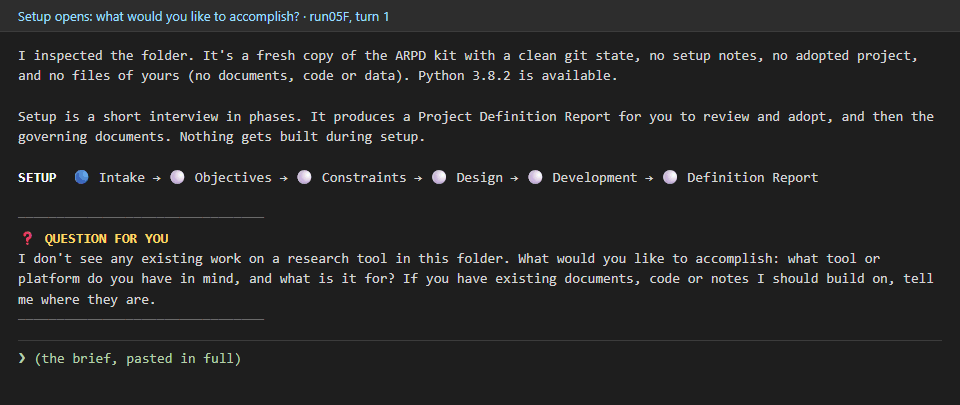

Paste this whole brief as your answer:

### Typical questions, in the usual order

#### The brief: paste this whole text as your first answer

**Reply:**

```text
I want a simple Spades card game with a window (GUI) that I can play on this computer: me plus
three computer players. The player opposite me is my partner. Use Python with its built-in Tkinter
and no other packages. Keep it simple: no networking, no card images (text like "Q♥" is fine), no
saving or resuming games, no clever AI. A later version could be networked; not now.

Rules: standard four-player partnership Spades.
- 52 cards, 13 each, aces high. The first dealer is random; then the deal passes clockwise.
- Bidding starts left of the dealer and goes clockwise, one round, no passing. Each player bids
  0-13; a bid of 0 is nil. No blind nil. A team's bid is the sum of the partners' bids.
- The player left of the dealer leads first. Players must follow suit if they can; otherwise they
  may play any card. The highest spade wins the trick, or else the highest card of the suit led.
  The winner leads next.
- Spades may not be led until a spade has been played on another suit, unless the leader holds only
  spades.
- A team that makes its bid scores 10 x bid, plus 1 per extra trick (a "bag"); a team that falls
  short scores -10 x bid. Nil scores +100 if that player takes no tricks, -100 if they take any; the
  partner's bid is scored on its own, and a nil bidder's tricks don't count toward it but always count
  as bags, whether or not the team makes its bid. Every 10 bags costs 100 points; extra bags carry
  over.
- The first team to 500 wins. If both reach 500 on the same hand, the higher score wins. If the
  scores are tied, play another hand.

Computer players use exactly these rules, nothing more. They choose only from the cards they may
legally play. Card order for "lowest" and "highest": non-spades by rank (on equal rank, clubs <
diamonds < hearts), then spades by rank. A card "would win" if it beats every card played to the
trick so far. "Above 10" means J, Q, K or A. The bid count adds up its three parts.
- Bid: count 1 per ace, 1 per king with at least one other card of its suit, and 1 per spade beyond
  the third. If the count is 0 and the hand has no spade above 10, bid nil; otherwise bid the count,
  at least 1.
- Lead: the highest card of its longest non-spade suit (on equal length: clubs, then diamonds, then
  hearts); if it may lead only spades, its lowest spade.
- Not leading: if its partner is winning the trick, play its lowest card; otherwise its lowest card
  that would win; if none would win, its lowest card.
- If it bid nil: lead its lowest card; otherwise play its highest card that would not win, or, if
  every card would win, its highest card. Its partner plays normally.

Aim for a first demonstration: as soon as there is a window I can click through, stop and ask me
to try it, before refining or polishing anything.

In the window: my hand as clickable cards, with only legal cards active; the four cards on the
table; each player's bid and tricks; both teams' scores and bags; computer plays shown with a short
pause; buttons to bid 0-13; a summary after each hand; a new-game button at the end.

Play log: record every bid and every card played, and save it as a CSV file in a "data" folder,
one file per game, named by the date and time the game started. Write the finished hands at the
end of each hand, so a game stopped part-way keeps them. One row per bid or card, with these columns:
- game_id: the same for every row of one game
- hand: 1, 2, 3, ...
- trick: 1-13 for cards; blank for bids
- seat: S, W, N or E (I am S, my partner N)
- player: human or computer
- team: NS or EW
- action: bid or play
- value: the bid (0-13), or the card as rank and suit letters, such as QH or 10S
- legal_options: how many legal choices that player had
- think_seconds: for my actions, seconds from when I could act to my click; blank for computers
- trick_winner: on the last card of each trick, the seat that won it; otherwise blank
- timestamp: date and time of the action
The log holds only my own play on this computer, with no names.

Details, so you don't need to ask:
- Seats go S, W, N, E clockwise; "left of the dealer" is the next seat clockwise.
- Every bag scores 1 point, including a nil bidder's tricks. Every full 10 bags costs 100, even
  several times in one hand.
- A spade led by a player who holds only spades breaks spades.
- Computer plays pause about 1 second (no pause in tests). With only one legal card, still wait for
  my click.
- Play log: game_id and the file name use the game's start time (data/spades-YYYYMMDD-HHMMSS.csv);
  timestamps are this computer's local time to the second; legal_options on a bid row is 14. A game
  stopped part-way just ends after its last finished hand. Keep the data folder out of git.
- If the all-computer test can't finish within 200 hands under these rules, tell me; don't change a
  rule.

Tests: the rules, the scoring, each computer rule, the play log (a hand gives 4 bid rows and 52
card rows, with the columns above), and a game played by four computer players to the end, which
fails if no team has won within 200 hands. No test may open the window or wait for a click:
test the game logic without the window.
```

If ARPD asks later what you want, or whether there is existing work, reply: "The brief in my first message covers it; there is no existing work."

## 2 · Setup: about you and the project

**Intake** is the first phase of the interview. ARPD works out who you are, what you want to build,
where the project will live, and what role it should play. Your brief already answers most of it, so
expect only a handful of questions, about 5 minutes.

Two things happen here that are worth knowing about:

- **ARPD turns this folder into your project.** It shows you a preview (a "dry run") of what moves,
  then moves its own files and the old git history into a backup folder beside this one. Nothing is
  deleted. Choose *here, in this folder*: choosing a new folder means reopening Claude Code there.
- **ARPD's role.** You choose how far ARPD questions your design. For this demo, it simply builds
  what you specified.

Phase 2 ends with a summary of what ARPD has understood; confirm it if it matches the brief.

### Typical questions, in the usual order

#### 1. Where should the project live?

*ARPD may word it as:* "Where should the project live?"

**Reply:**

```text
Here, in this folder.
```

Choose this folder (usually option A). A new folder means reopening Claude Code there.

<details><summary>Example from a real run</summary>

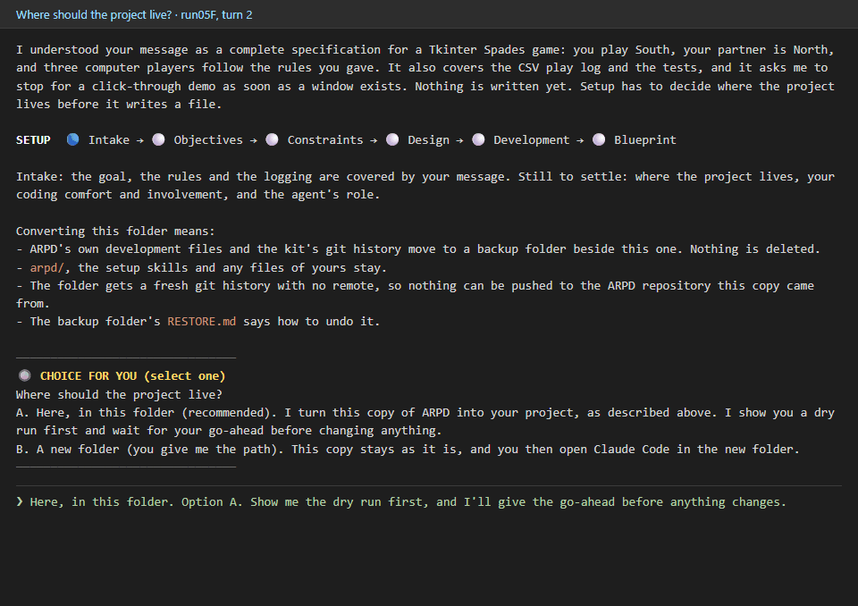

</details>

#### 2. Convert this folder as shown? (after the dry run)

*ARPD may word it as:* "Convert this folder as shown?" / "Convert this folder as the dry run shows?" / "Convert this folder as shown above?"

**Reply:**

```text
Yes, convert as shown.
```

The dry run lists what moves to the backup folder. Nothing is deleted.

<details><summary>Example from a real run</summary>

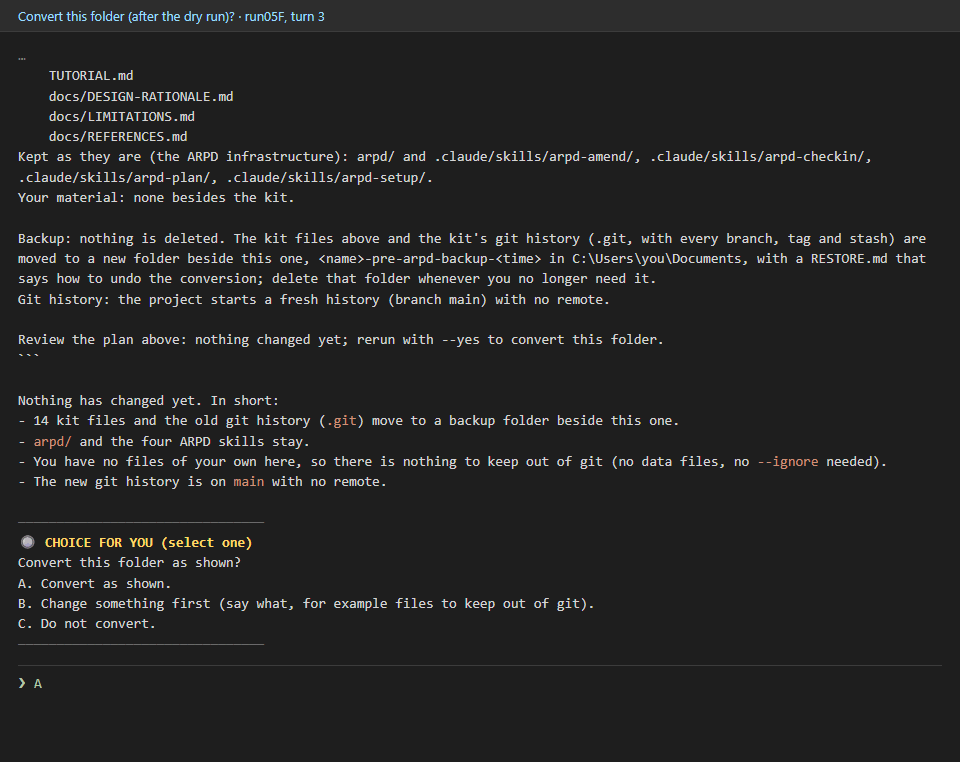

</details>

#### 3. What role would you like me to play? (A to F)

*ARPD may word it as:* "What role would you like me to play in this project?"

**Reply:**

```text
A
```

A: ARPD builds what you specified and raises only problems that would stop it working.

<details><summary>Example from a real run</summary>

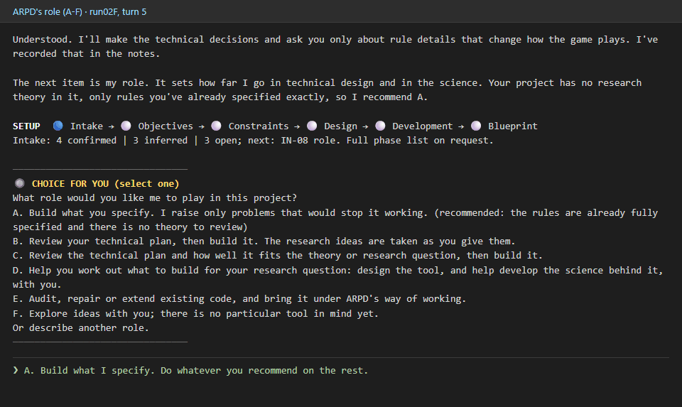

</details>

#### 4. How comfortable are you with code, and how involved do you want to be?

*ARPD may word it as:* "How comfortable are you with code: do you write it, run scripts others wrote, or prefer not to touch it?" / "How comfortable are you with code?" / "How comfortable are you with code, and how involved do you want to be in technical decisions"

**Reply:**

```text
I can run scripts but prefer not to write code. Ask me about the game rules, not technical details.
```

<details><summary>Example from a real run</summary>

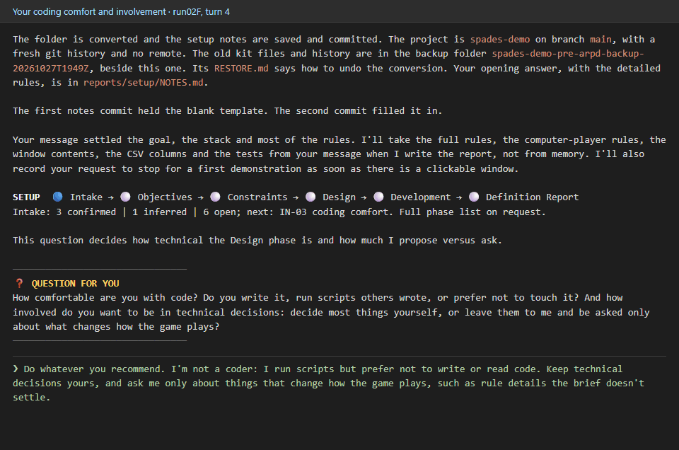

</details>

#### 5. Is this summary of Intake right?

*ARPD may word it as:* "Is this summary of Intake right?"

**Reply:**

```text
Yes, that's right. Continue.
```

**Or just the letter for yes:**

```text
A
```

Every phase ends with a summary. Skim it: if it matches the brief, say yes. A yes only confirms the summary; it adopts nothing.

### Other questions you may see

#### Who will play or use it?

**Reply:**

```text
Only me, on this computer.
```

#### Is there existing work, or what would you like to accomplish? (asked again)

*ARPD may word it as:* "What would you like to accomplish: what tool or platform do you have in mind, and what is it for?" / "What would you like to accomplish?"

**Reply:**

```text
The brief in my first message covers it; there is no existing work.
```

## 3 · Setup: what it is for

**Objectives** is about purpose: what the game is for, what it must do, what it will not do, and
what would convince you that it works. ARPD turns your answers into the requirements and the
acceptance checks the agents must meet later. Because this demo has no research question, ARPD
skips the theory questions it would ask on a research project. A few questions, about 3 minutes.

### Typical questions, in the usual order

#### 1. What will you use the play log (or the game) for?

*ARPD may word it as:* "What will you do with the play logs?" / "What will you do with the play log files once you have them?" / "What will you do with the play log files: for example, look at them yourself in a spreadsheet, feed them to some analysis later, or share them with someone else?"

**Reply:**

```text
Just play it and study my own play.
```

<details><summary>Example from a real run</summary>

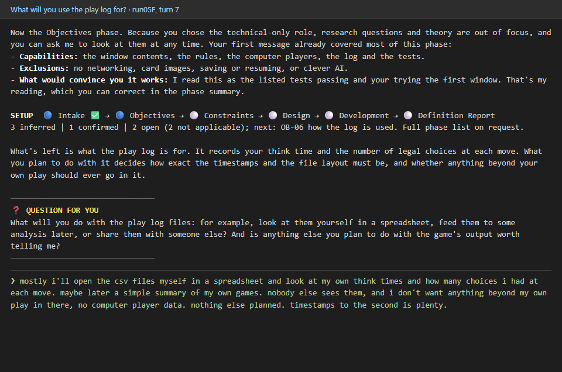

</details>

#### 2. What would convince you that the game works?

*ARPD may word it as:* "When the game is finished, what would convince you that it works?" / "When the game is built, what would convince you that it works?" / "What would convince you that the game works?"

**Reply:**

```text
I can play a hand in the window, the computer players follow the stated rules, and the play log opens in a spreadsheet with one row per bid and card. Tests check the rules, the scoring, each computer rule, the play log, and a full all-computer game to 500.
```

#### 3. Is this summary of Objectives right?

*ARPD may word it as:* "Is this summary of Objectives right?" / "Is this summary of Objectives right, including my seven proposed checks?"

**Reply:**

```text
Yes, that's right. Continue.
```

**Or just the letter for yes:**

```text
A
```

Every phase ends with a summary. Skim it: if it matches the brief, say yes. A yes only confirms the summary; it adopts nothing.

<details><summary>Example from a real run</summary>

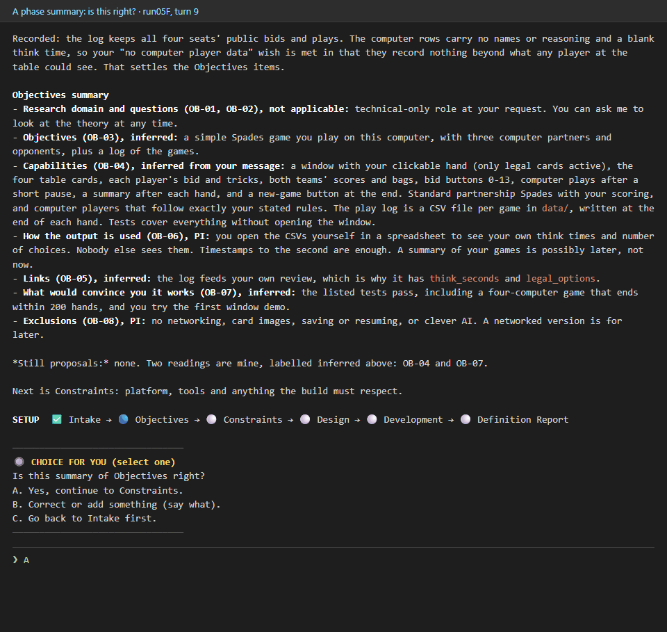

</details>

### Other questions you may see

#### What should the log contain, or how should hand results appear?

*ARPD may word it as:* "Which play-log format do you want?" / "What should the log contain?" / "Do you want a win-versus-computers check as part of the tests?" / "Should hand results be in the log files?"

**Reply:**

```text
The columns in my first message define the log. Add nothing else.
```

#### Do you want a win-versus-computers check, or other extra tests?

*ARPD may word it as:* "Do you want a win-versus-computers check as part of the tests?" / "Beyond those automated tests, what would make you say "this works"?"

**Reply:**

```text
No, the tests in my brief are enough.
```

## 4 · Setup: limits

**Constraints** collects the limits the work must respect: the computer it runs on, the language
and packages, whether it must work offline, and how much agent use (cost) is acceptable. ARPD sorts
them into *musts* and *preferences*. It also checks your rules for contradictions; if it finds gaps,
it usually saves them for the next phase. Usually one or two questions and a summary, about 3
minutes.

### Typical questions, in the usual order

#### 1. Any other limits? (other computers, Python version, cost)

*ARPD may word it as:* "Is there any limit on the agent work, such as a cap on credit or usage, or a preference to keep it cheap, even if that means fewer independent review passes?" / "Is "this Windows computer, Python 3.8 as installed" enough, or must it also run elsewhere" / "Does it need to run on anything besides this Windows computer"

**Reply:**

```text
My own computer, offline. Python with Tkinter only, no extra packages. Keep agent use low.
```

ARPD sorts these into musts and preferences, and may list its own defaults for you to correct.

<details><summary>Example from a real run</summary>

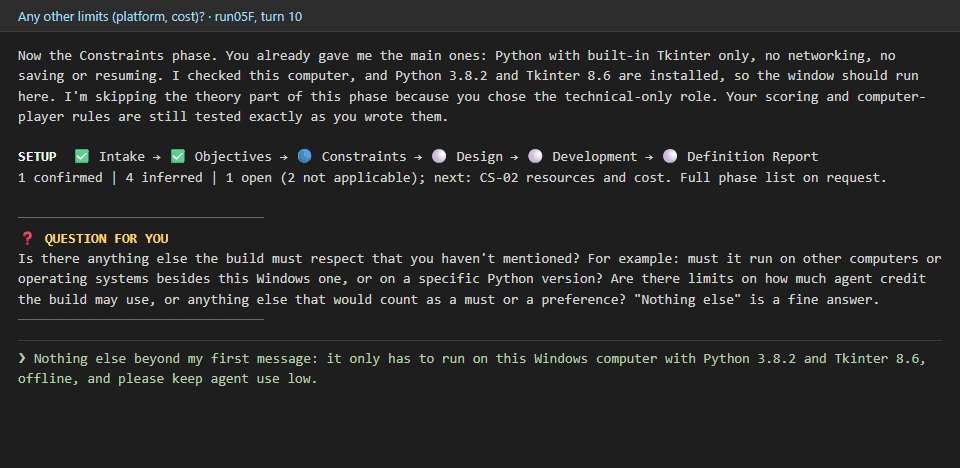

</details>

#### 2. Is this summary of Constraints right?

*ARPD may word it as:* "Is this summary of Constraints right?" / "Is this summary of Constraints right, including C-7?"

**Reply:**

```text
Yes, that's right. Continue.
```

**Or just the letter for yes:**

```text
A
```

Every phase ends with a summary. Skim it: if it matches the brief, say yes. A yes only confirms the summary; it adopts nothing.

### Other questions you may see

#### When a team misses its bid, what happens to the nil bidder's tricks?

*ARPD may word it as:* "When a nil bidder takes tricks, or a team misses its bid, does each bag from those tricks score a point?"

**Reply:**

```text
As my brief says: a nil bidder's tricks always count as bags and score 1 point each, whether or not the team makes its bid.
```

ARPD checks your rules for contradictions in this phase and asks when two rules seem to disagree.

## 5 · Setup: rules and data

**Design** settles how the game is built and what its data mean. ARPD proposes a simple design
(game logic kept apart from the window, so tests can run without opening it) and then asks about
anything in the rules or the play log that your brief leaves open.

The brief's *Details* paragraph settles nearly everything ARPD asked about here in our test runs:
seat order, bag scoring, the pause, timestamps and file names. So Design is now usually short: in our
runs with this brief, often just "Are you ready to move on?", sometimes a short list of play-log
defaults to accept. When ARPD does ask about a rule or what a recorded number means, that is because
those are yours to decide. About 2 minutes.

> **Look here:** game rules and the meaning of the data are *your* decisions, not the agents'. When
> your brief leaves something open, ARPD asks rather than guesses, and records your answer as a
> ruling. In a real study this is where measurement validity is decided. For the demo, the reply
> "Do whatever you recommend, consistent with traditional Spades." is fine.

### Typical questions, in the usual order

#### 1. Do you accept these readings / defaults? (a short numbered list)

*ARPD may word it as:* "Do these seven scoring readings match your rules?" / "Do these eight log details match what you want?" / "Do you accept these six log defaults?" / "Are these eight log details right?" / "Do these log conventions suit how you'll study your play?" / "Do these five defaults work for the log?" / "Do you accept this design?"

**Reply:**

```text
Yes, accept them all as proposed.
```

**Or just the letter for accept:**

```text
A
```

ARPD lists how it will read anything the brief still leaves open (often small play-log details) and asks you to accept them in one go. Check that the list matches the brief. With the brief's Details paragraph, it may not appear at all.

<details><summary>Example from a real run</summary>

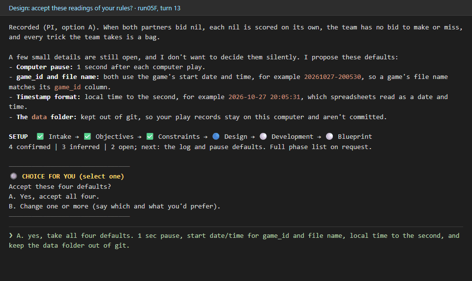

</details>

#### 2. Are you ready to move on from the design?

*ARPD may word it as:* "Are you ready to move on from the design to how the agents will build it, or would you like to explore or revise any part first?" / "Are you ready to move on from the design to how the agents will build it, or would you like to explore or revise any part of the design first?"

**Reply:**

```text
A
```

Choose the option that continues to Development. This is often the only Design question.

#### 3. Is this summary of Design right?

*ARPD may word it as:* "Is this summary of Design right, and is the design ready to move to Development?" / "Is this summary of Design right, and are you ready to move on?"

**Reply:**

```text
Yes, that's right. Continue.
```

**Or just the letter for yes:**

```text
A
```

Every phase ends with a summary. Skim it: if it matches the brief, say yes. A yes only confirms the summary; it adopts nothing.

### Other questions you may see

#### When does think time start and stop? (or: how precise should think_seconds be?)

*ARPD may word it as:* "Sometimes you will have exactly one legal card to play"

**Reply:**

```text
From when my bid buttons or legal cards become active to my click, in seconds to two decimals.
```

This is about what a recorded number means: in a real study, where measurement validity is decided. ARPD may ask, or propose an answer for you to accept.

#### What happens when both partners on a team bid nil?

*ARPD may word it as:* "What should happen when both players on a team bid nil?"

**Reply:**

```text
Score each nil on its own: +100 or -100 for each partner. The team's bid is 0, so there are no 10 x bid points, and all their tricks count as bags.
```

ARPD may ask, or settle this itself with the traditional rule and list it for you to accept.

#### After the fourth card, what should the table do?

*ARPD may word it as:* "After the fourth card, what should the table do?"

**Reply:**

```text
Use your recommendation: keep the trick on the table for a moment, then clear it.
```

#### Which part of the design would you like to explore or change?

*ARPD may word it as:* "Which part of the design would you like to explore or change, and what do you have in mind?"

**Reply:**

```text
None. Continue to Development.
```

This follows if you chose to revise the design; if you didn't mean to, just continue.

#### Another question about one rule detail

*ARPD may word it as:* "After a computer's nil has failed, how should it play the rest of that hand?" / "When may a spade be led?" / "When a leader with only spades leads a spade, do spades count as broken afterwards?" / "After you've tried python -m spades, how does it look and feel, and what should change before the final sprint"

**Reply:**

```text
Do whatever you recommend, consistent with traditional Spades.
```

Game rules are your decision, so ARPD asks instead of guessing, often with an example and options A/B. Pick the option that matches how you play, or use the reply above.

<details><summary>Example from a real run</summary>

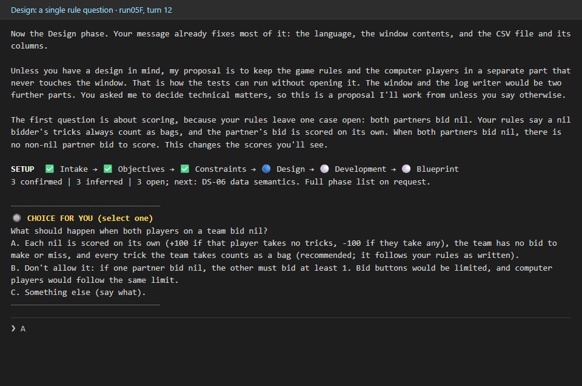

</details>

#### How should a nil bidder's tricks be scored? (do they also score +1 as bags?)

*ARPD may word it as:* "How should a nil bidder's tricks be scored?" / "You wrote that a nil bidder's tricks "always count as bags". Does each of those tricks also score +1 point, like any other bag?"

**Reply:**

```text
As my brief says: every bag scores 1 point, including a nil bidder's tricks.
```

#### When may spades be led? Does a spade led by someone holding only spades break spades?

*ARPD may word it as:* "Should a spade led by a player who holds only spades break spades?" / "When may a spade be led?"

**Reply:**

```text
As my brief says: a spade led by a player who holds only spades breaks spades.
```

#### Which way does clockwise go / what is the seat order?

*ARPD may word it as:* "Which way does clockwise go around the table?"

**Reply:**

```text
Yes: S, W, N, E clockwise.
```

#### Should the game still wait when you have only one legal card?

*ARPD may word it as:* "Sometimes you will have exactly one legal card to play"

**Reply:**

```text
As my brief says: still wait for my click.
```

#### Timestamps: time zone and format

*ARPD may word it as:* "Which time zone should the timestamps and file names use?" / "How should the timestamp column be written in the play log?"

**Reply:**

```text
As my brief says: this computer's local time, to the second.
```

#### How should a quit game be told apart from a finished one?

*ARPD may word it as:* "How should a quit game be told apart from a finished one?"

**Reply:**

```text
As my brief says: a game stopped part-way just ends after its last finished hand.
```

#### Which program shape / layout should the build use?

*ARPD may word it as:* "Is this layout and flow right?" / "Which program shape should the build use?"

**Reply:**

```text
Use your recommendation: the simplest design that keeps the rules testable without the window.
```

#### Do you want any change to this design?

*ARPD may word it as:* "Do you want any change to this design or to the small details above?"

**Reply:**

```text
No changes.
```

## 6 · Setup: how the agents work

**Development** sets up the team: how the agents are organized (for example, one agent builds and a
fresh reviewer checks each change), how much they may do on their own, when they stop for you, and
which features come first. **For the demo, choose the options that let the agents work most
independently:** the simplest team, the most hands-off arrangement, and the whole game as the first
priority. A few questions and a summary, about 4 minutes.

### Typical questions, in the usual order

#### 1. How should the agents work on this project? (A to D)

*ARPD may word it as:* "How should the agents work on this project?"

**Reply:**

```text
A
```

A: one agent builds and a fresh reviewer agent checks each change. The simplest and cheapest.

<details><summary>Example from a real run</summary>

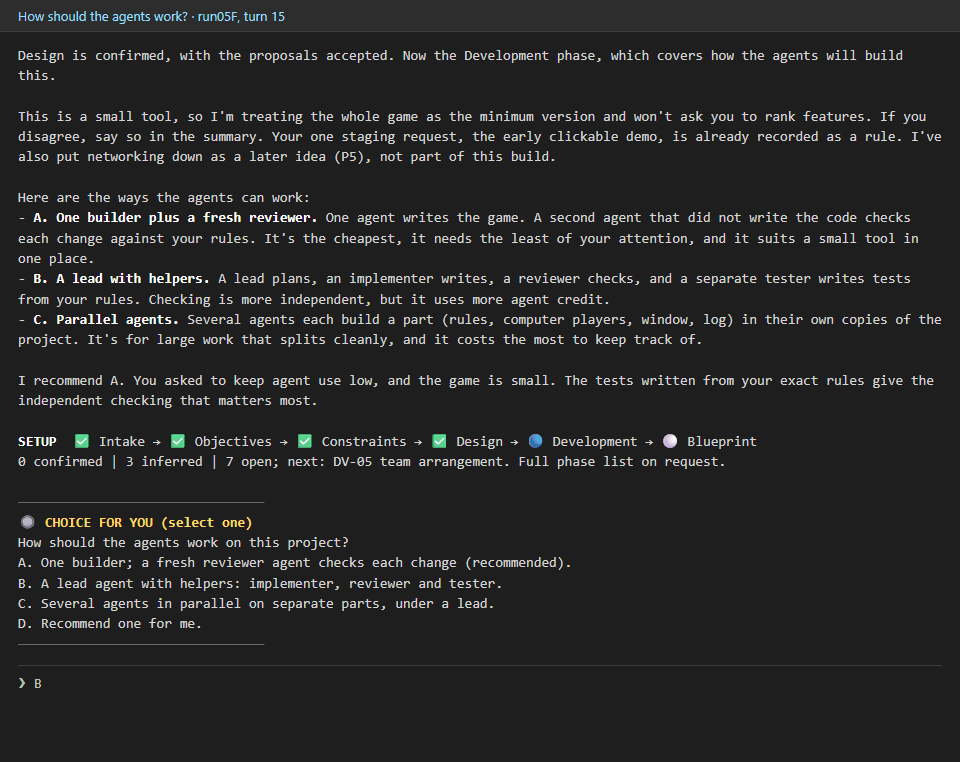

</details>

#### 2. Is there anything more you want to set about how the agents run?

*ARPD may word it as:* "Is there anything more you want to set about how the agents run?" / "Is there anything more you want to set about how the agents run, beyond your first-demonstration rule?"

**Reply:**

```text
No, nothing more.
```

#### 3. A working package: review depth, how far the agents may go alone, which features first

*ARPD may word it as:* "How much of the work do you want to review?" / "Do you accept this autonomy, review, authority, module and priority proposal?" / "How much of the team's work do you want to read and approve?" / "How should sprint autonomy work for this project?"

**Reply:**

```text
Use the most hands-off option you offer.
```

**If it offers to accept the package as proposed:**

```text
A
```

For the demo, choose the arrangement that lets the agents work most independently. Game rules and the meaning of the data stay yours whatever you choose.

<details><summary>Example from a real run</summary>

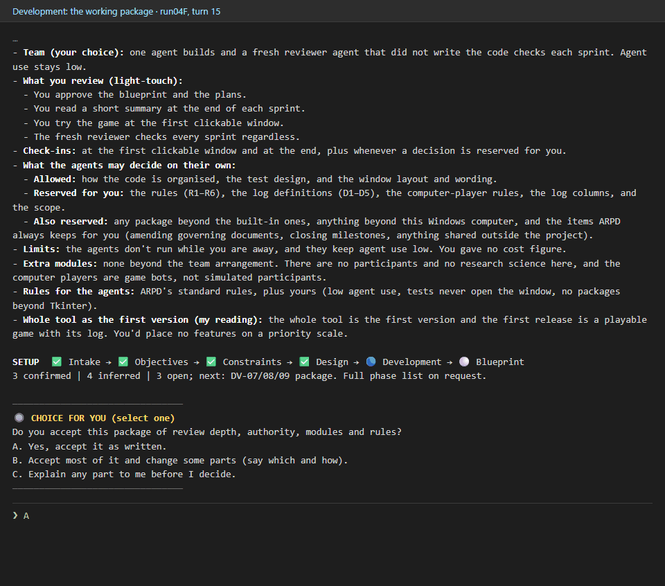

</details>

#### 4. Is this summary of Development right?

*ARPD may word it as:* "Is this summary of Development right?" / "Is this Development summary and rules list right?"

**Reply:**

```text
Yes, that's right. Continue.
```

**Or just the letter for yes:**

```text
A
```

Every phase ends with a summary. Skim it: if it matches the brief, say yes. A yes only confirms the summary; it adopts nothing.

### Other questions you may see

#### Where should the later networked version go? (P1 to P5)

*ARPD may word it as:* "Where should a later networked version go" / "Is this placement right" / "Where should the networked version go"

**Reply:**

```text
P5: just an idea for later.
```

#### How should the work move from one sprint to the next?

*ARPD may word it as:* "How should the team move from one sprint to the next?" / "How should the work move from one sprint to the next?"

**Reply:**

```text
Continue to the next sprint after each review, unless something needs my decision.
```

## 7 · Adopt the definition

ARPD now writes the **Project Definition Report** (`reports/setup/PROJECT-DEFINITION.md`): one
document with everything you agreed, the requirements with their acceptance checks, and any open
items. It runs its own check on the report, summarizes it, and asks you to adopt it. **Adopting is
one of the three answers that commit you**, so look at the report first. After adoption, ARPD writes
the project's governing documents (the team charter `CLAUDE.md`, `REQUIREMENTS.md`, `DECISIONS.md`
and others) and may ask to include its logging and agent-role files. About 5 minutes, mostly ARPD
writing.

> **Look here:** open `reports/setup/PROJECT-DEFINITION.md` in any text editor. Check that the game
> rules and the computer players' rules are recorded as yours, and that nothing you did not ask for
> has crept in.

### Typical questions, in the usual order

#### 1. How do you want to handle the report (or its proposals)?

*ARPD may word it as:* "How would you like to go on with report vN?" / "How do you want to proceed with the report?" / "How do you want to handle the report?"

**Reply:**

```text
Accept your proposals as written, and go to adoption.
```

**Or the letter:**

```text
A
```

Look at reports/setup/PROJECT-DEFINITION.md first. This choice does not adopt anything yet.

<details><summary>Example from a real run</summary>

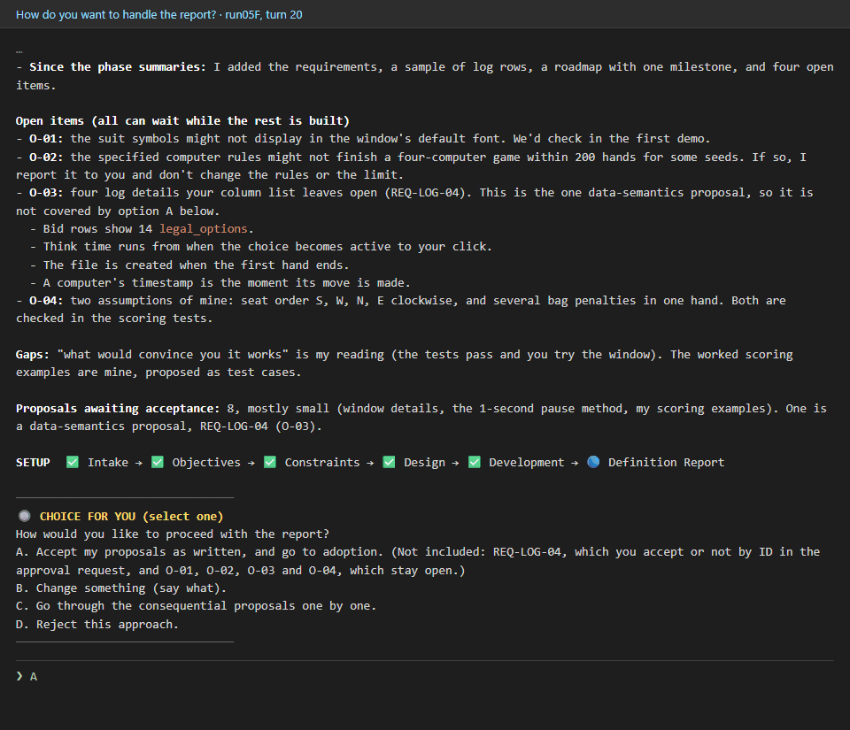

</details>

#### 2. Adopt the Project Definition Report?

*ARPD may word it as:* "Adopt reports/setup/PROJECT-DEFINITION.md vN?"

**Reply:**

```text
Yes, I adopt this version of the Project Definition Report, and I accept every proposal you listed for me to name.
```

One of the three answers that commit you: say yes only if the report matches what you asked for. ARPD may list a few proposals (often readings of what a log column means) that are accepted only if you name them. If it asks you to name them, copy their IDs from its message; never from this page. If you leave them out, they stay open and block the part of the build that needs them.

<details><summary>Example from a real run</summary>

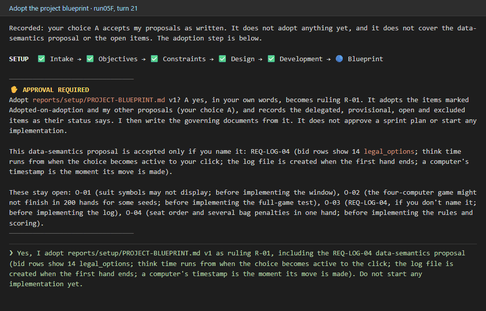

</details>

#### 3. Include ARPD's logging and agent-role files?

*ARPD may word it as:* "Approve including the event-logging and agent-role files in this project?"

**Reply:**

```text
Yes, include both.
```

<details><summary>Example from a real run</summary>

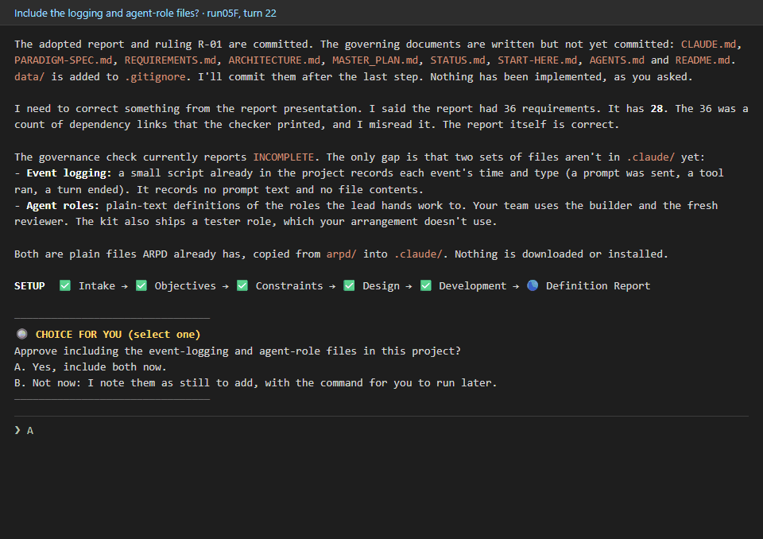

</details>

#### 4. Setup is complete. What next?

*ARPD may word it as:* "Setup is complete. Your Project Definition Report is adopted and the governing documents are written. What next?"

**Reply:**

```text
Plan the first piece of work now.
```

**Or the letter:**

```text
A
```

<details><summary>Example from a real run</summary>

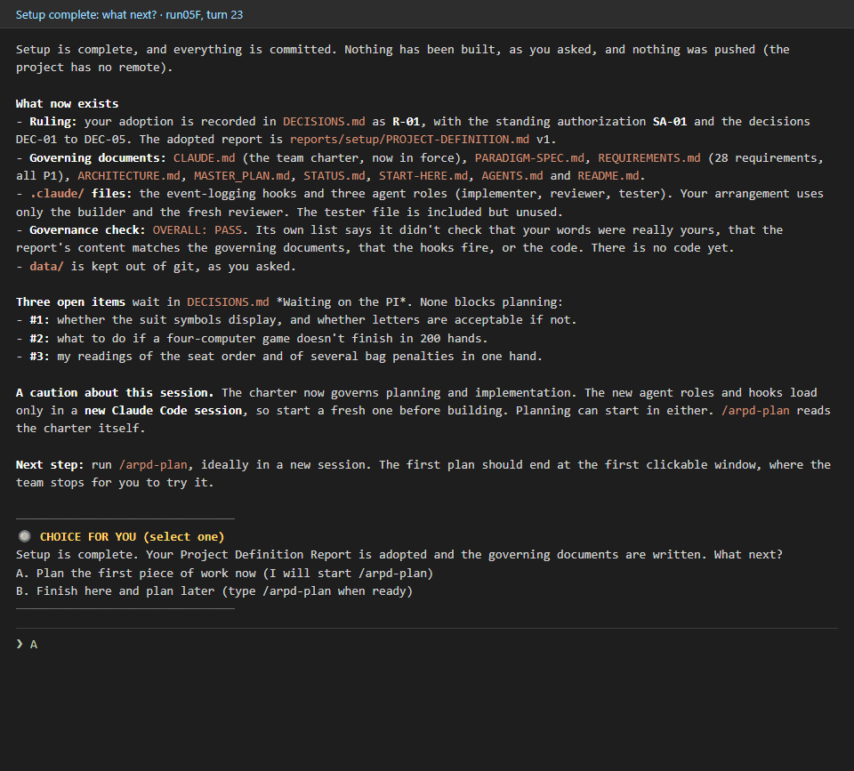

</details>

### Other questions you may see

#### A late rule question before adoption

*ARPD may word it as:* "After a computer's nil has failed, how should it play the rest of that hand?" / "When may a spade be led?" / "How much may the agents decide without asking you?"

**Reply:**

```text
Do whatever you recommend, consistent with traditional Spades.
```

#### Which do you mean for an open item?

*ARPD may word it as:* "Which do you mean for O-01 and O-02, given that D-05 and D-06 are accepted?"

**Reply:**

```text
Use your recommendation.
```

**Check that setup worked.** When ARPD says setup is complete, paste:

```text
Run the setup check and show me the result as a short checklist.
```

You should see ✅ lines (governing documents present, the adoption recorded, and so on) ending in
`OVERALL: PASS`.

## 8 · Plan the build

Planning turns the adopted definition into a concrete plan. ARPD reviews where the project stands,
asks what you want this piece of work to achieve, sizes it (usually two *sprints* here: the game
logic with its tests, then the window), and writes a versioned plan under `reports/planning/`. You
approve that exact version, then say whether to start now. **Approving the plan and starting the
build are the other two answers that commit you.** Approval alone starts nothing. About 5 minutes.
If ARPD offers to start planning at the end of setup, accept; otherwise type `/arpd-plan`.

**For the demo, plan the whole first version at once and let the agents carry on between sprints
without stopping.** The aim is the first clickable demonstration.

### Typical questions, in the usual order

#### 1. What would you like to build or accomplish next?

*ARPD may word it as:* "Do you know what you would like to build or accomplish next?"

**Reply:**

```text
The first playable version: the whole game as defined, with its tests. Stop at the first window I can click and ask me to try it.
```

Sometimes ARPD takes the goal from the adopted report and skips this question.

#### 2. Plan the next sprint only, or several sprints together?

*ARPD may word it as:* "Would you like to plan the next sprint only, or map out several sprints as one coordinated effort?" / "How much should I plan now?"

**Reply:**

```text
Several sprints as one plan: the whole first version.
```

<details><summary>Example from a real run</summary>

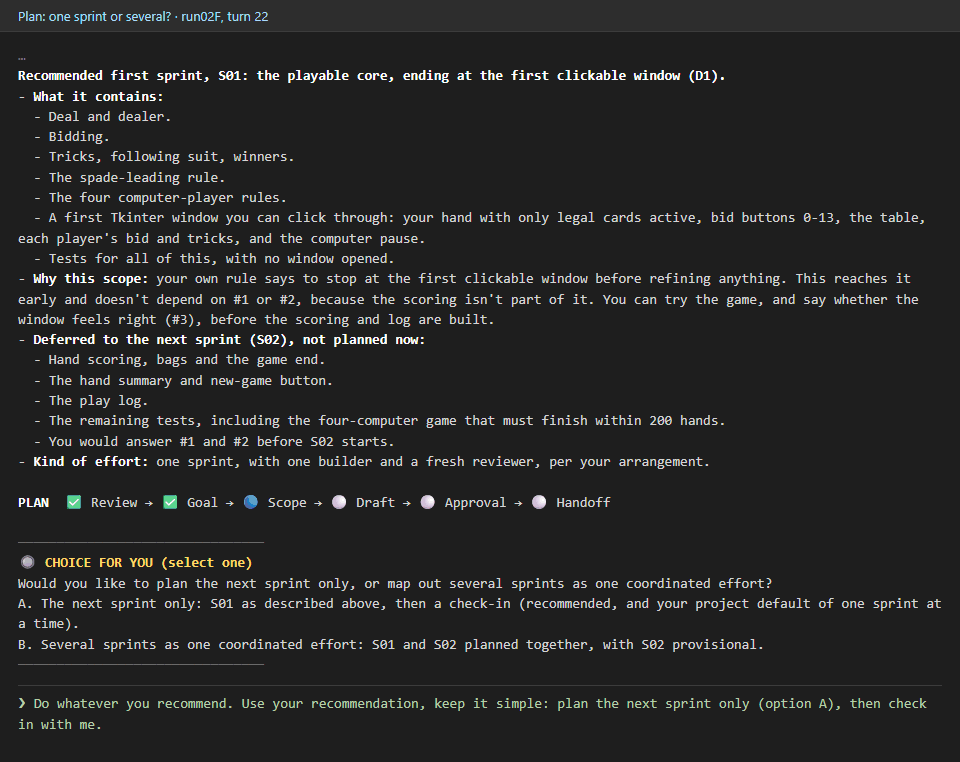

</details>

#### 3. How should the team move from one sprint to the next?

*ARPD may word it as:* "How should the team move from one sprint to the next?" / "How should the work move from one sprint to the next?"

**Reply:**

```text
Continue to the next sprint after each independent review, unless something needs my decision.
```

<details><summary>Example from a real run</summary>

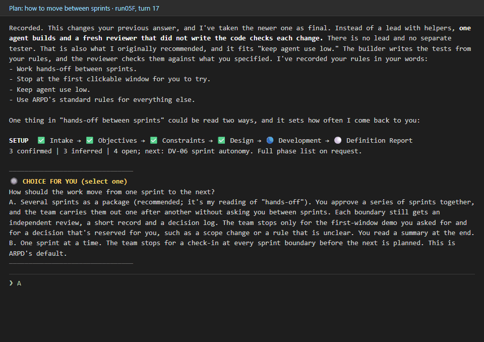

</details>

#### 4. What would you like to do with the draft plan?

*ARPD may word it as:* "How would you like to go on with PLAN-… vN?" / "What would you like to do with PLAN-… vN?" / "How would you like to proceed with PLAN-… vN?" / "The draft is yours to examine, edit or have reviewed. Nothing is approved until you say so. What next?"

**Reply:**

```text
It looks right: go to approval.
```

**Or the letter:**

```text
A
```

The plan is saved under reports/planning/. A fresh-agent review is optional; skip it for the demo.

#### 5. Approve the plan?

*ARPD may word it as:* "Approve reports/planning/PLAN-….md vN"

**Reply:**

```text
Yes, I approve this version of the plan.
```

One of the three answers that commit you. Approval alone starts nothing.

<details><summary>Example from a real run</summary>

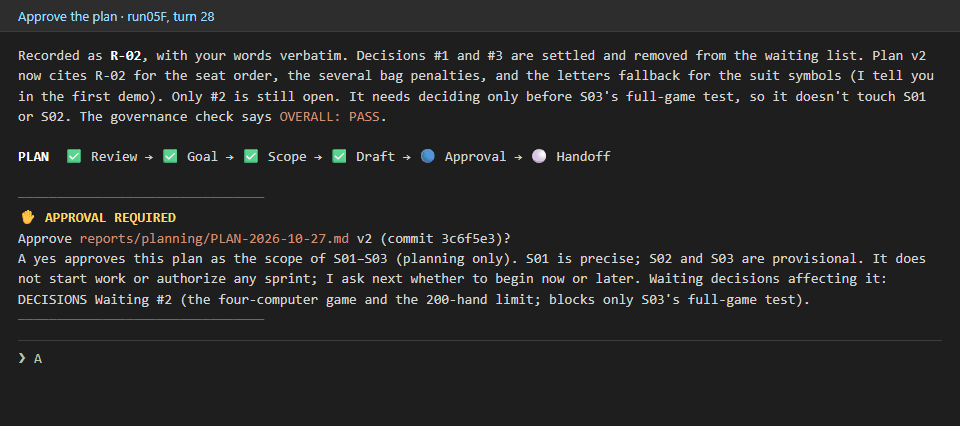

</details>

#### 6. Begin implementation now or later?

*ARPD may word it as:* "Would you like to begin implementation now or later?"

**Reply:**

```text
Start now: the whole series, continuing between sprints, and stop at the first clickable window so I can try it.
```

**Or the letter of the option that starts the whole series now:**

```text
B
```

The third answer that commits you: this starts the build. The letters differ between runs, so check which option starts the whole series. If you choose later, ARPD gives you a prompt to paste when you are ready.

<details><summary>Example from a real run</summary>

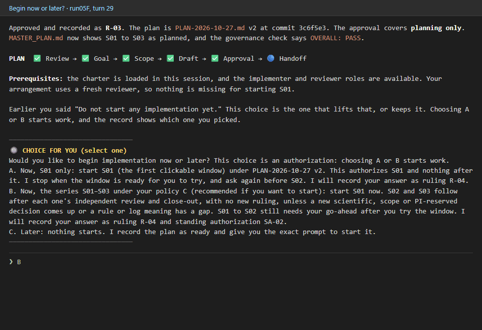

</details>

### Other questions you may see

#### Does this scope (or this series of sprints) match what you want?

*ARPD may word it as:* "Does this scope match what you want for the first sprint?" / "Does this scope match what you want for the first plan?" / "Does this scope match what you want?"

**Reply:**

```text
Yes.
```

#### Is there a deadline or timeline?

**Reply:**

```text
None.
```

#### How do you want to answer the decisions the plan raised?

*ARPD may word it as:* "How do you want to answer the four decisions?" / "Settle #3 and #1 as I recommend?"

**Reply:**

```text
Do whatever you recommend, consistent with traditional Spades.
```

#### What does "continue" mean here? (an authorization question)

*ARPD may word it as:* "What does "continue" mean here?" / "This is an authorization. Choosing A starts the series."

**Reply:**

```text
Start now: the whole series, continuing between sprints.
```

#### Type /compact (or start a new session), then paste this prompt

*ARPD may word it as:* "Type /compact, then paste the prompt below"

**Reply:**

```text
/compact
```

**Then paste the prompt ARPD gave you, or:**

```text
continue
```

ARPD sometimes asks for this before the build so the agents start with a clean context.

**Before the build starts, ARPD may ask you to type `/compact`** (or to start a new session) so that
the agents start with a clean context. Do it, then paste the prompt it gives you. With Sonnet,
clearing the context here is a good idea anyway: type `/clear`, then `/arpd-plan` and say
`continue`; ARPD reads where things stand from the project's files.

## 9 · The build

The agents now write the game and its tests, and a separate reviewer agent checks the work. This
is the longest part (about 20–40 minutes). You mostly wait.

**What is normal:**

- Tool activity scrolling by, and test runs.
- **⏳ WORKING** or *"Waiting for 1 background agent to finish"*: a reviewer is checking the work.
  Do nothing; ARPD continues when it finishes.
- A question in the middle of the build about a rule detail. Answer it (see the cards below).
- **The context fills up.** On a long build Claude Code may compact the conversation automatically,
  or ARPD may ask you to. Afterwards, type `continue`.

**What to expect, from the study runs:** in all five study builds, the first sprint ran as one long
stretch of 8 to 30 minutes, with tests and an independent review, and ended with ARPD asking you to
try the window. Setup to clickable game took 46 to 71 minutes in total. Only one build stopped
part-way, for a single rule question.

**At any time** you can type `/arpd-checkin` to see what is done, what is in progress, and what (if
anything) needs you.

### Typical questions, in the usual order

#### 1. A rule question in the middle of the build

*ARPD may word it as:* "Before the play log gets built: what should legal_options hold on a bid row?" / "Does each of a nil bidder's tricks score +1 point, as well as counting toward the 10-bag penalty?"

**Reply:**

```text
Do whatever you recommend, consistent with traditional Spades.
```

The build pauses only for decisions that are yours. Answer, and it carries on.

#### 2. Nothing seems to be happening

*ARPD may word it as:* "(no question: the agents stopped mid-work)"

**Reply:**

```text
continue
```

If a tool or a reviewer agent is still running (⏳ WORKING, "Waiting for … background agent"), wait instead. See Stuck? Resume.

## 10 · Try the game

When the first clickable version exists, ARPD stops and asks you to try it. This first demonstration
is often a deliberately partial game: in the study runs it sometimes came before the scores, the
hand summary or the play log, which follow in the next sprint. That is the point of stopping early:
you see something real before the agents build everything.

1. Open a **second** terminal in the same folder and start the game with the command ARPD gives you
   (in the study: `python -m spades`, `python main.py` or `python play.py`; on Windows `py` instead
   of `python`).
2. **Play one hand.** Bid, then click your cards; only the cards you may legally play are active.
3. If the play log is already built, open the newest CSV file in the `data` folder in a spreadsheet.
   Each row is one bid or card, with your think time on your own rows. What could you study with it?
   What would you add?
4. Tell ARPD what you saw, in plain words: either that it works, or what looks wrong. For example:

```text
It works: I played a hand and the CSV opened with one row per bid and card.
```

```text
My partner played a spade when it could have followed suit.
```

That is the normal loop: you report, the agents fix and test, and you check. "Built and reviewed"
by the agents still leaves your own check: only you can say the first version is done.

What a study build looked like (each run designs its own window, so yours will differ):

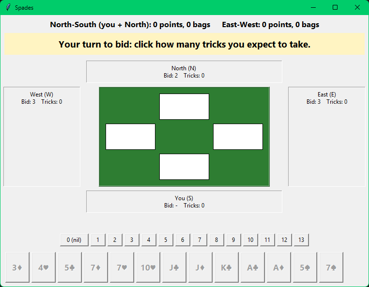

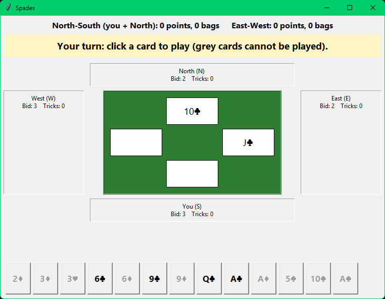

### Typical questions, in the usual order

#### Please try the window and tell me what you found

*ARPD may word it as:* "Please try the window and tell me what you found: did the suit symbols show" / "Please run python main.py, play at least one hand, and tell me what you saw" / "Please try the first window and tell the team what you found"

**If it works:**

```text
It works: I played a hand and it followed the rules. Use your recommendation on any open points, and go on.
```

**If something looks wrong, say what, for example:**

```text
My partner played a spade when it could have followed suit.
```

This is the first demonstration: a good place to pause and review. "Go on" lets the agents continue to the next sprint (scores, the full game, the play log).

<details><summary>Example from a real run</summary>

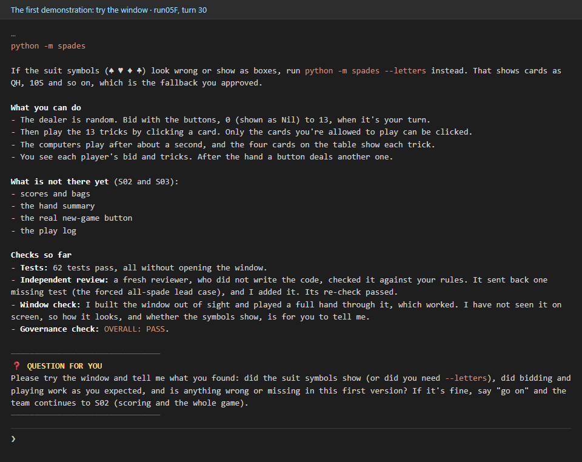

</details>

## Stuck? Resume and troubleshooting

**If ARPD seems to have stopped,** work down this list:

1. **Is something running?** Tool output, a spinner, ⏳ WORKING or "Waiting for … background
   agent": wait.
2. **Did it ask you something?** Look for the ❓ 🔘 ✋ block at the end of its last message and find
   the matching card.
3. **It stopped in the middle of work, with no question:** type `continue`.
4. **That didn't work:** type:

```text
Continue the current sprint under the approved plan.
```

5. **Not sure where things stand:** type `/arpd-checkin`. It shows a checklist of what is done, in
   progress and waiting, and the exact next prompt.
6. **The session is unusable** (closed, crashed, or you hit a usage limit): open Claude Code again in
   the same folder (`claude --model sonnet --effort low`), type `/arpd-checkin`, and follow its next
   step.

| Problem | What to do |
|---|---|
| `claude` is not found | Open a new terminal window. See the README, step 3 |
| The game window does not open | Run the Tkinter check from the README, step 4 |
| A command is blocked by Claude Code's safety check | ARPD gives you a one-line command starting with `!`; paste it and press Enter |
| Nothing happens for 10 minutes or more | Close any game window that has opened. If still stuck, press **Esc** and type `A command seems to be hanging, possibly a test that opened the game window. Stop it and continue.` |
| You hit a usage limit | Wait for it to reset, then `claude` and `/arpd-checkin` |
| ARPD asks something you don't understand | Ask it: `What does that mean, and what do you recommend?` |

## Your own project

The same steps work for a tool of your own: an experiment platform, a simulation, a survey or
measurement tool, a data pipeline, or an extension of this game.

1. **Start from a fresh copy.** Clone ARPD into a new folder named for your project (README, Start
   here, step 5), open Claude Code there, and type `/arpd-setup`.
2. **Describe what you want in your own words:** the question, the tool you think you need, who will
   use it, and what data it handles. A rough idea is fine; setup draws out the rest. Mention any
   existing notes, code or data, and say early if the tool will collect data from people.
3. **Choose ARPD's role.** *A* builds what you specify. *C* also reviews how well the design fits
   your theory or research question. *D* helps you work out what to build and develop the science
   behind it with you.
4. **Work through the phases.** Settle what is yours: the rules of the task, what each recorded value
   means, and what would convince you the tool works. On a real project, answer these yourself
   rather than delegating them.
5. **Read and adopt the Project Definition Report.** Nothing is built before this.
6. **Plan a small first piece** with `/arpd-plan`, aimed at a first demonstration you can try.
   Approve the exact version, then begin.
7. **Check in and review.** `/arpd-checkin` shows where things stand. Try each demonstration
   yourself. `/arpd-amend` changes a ruling or the charter. Plan the next piece with `/arpd-plan`.

**Start small.** A first demonstration you can try within a session teaches you more than a long
specification. For example, turn this game into a small experiment: give the computer partner two
strategies, assign one per game as the condition, and compare the play logs.

**Afterwards, look at:** `CLAUDE.md` (the team charter the agents work under), `DECISIONS.md` (your
rulings, word for word), `REQUIREMENTS.md` (each requirement and its evidence), `reports/` (the setup
record, the approved plan and the sprint close-outs) and `arpd/docs/GUIDE.md` (the full guide).
