# ARPD tutorial: build a Spades game

In this tutorial you use ARPD to have AI agents build a small Spades card game: a window in which
you play with three computer players, one of them your partner. The game also saves every bid and
card to a CSV file you can open in a spreadsheet.

The agents run in **Claude Code**, which works *agentically*: rather than only answering in a chat
window, it reads and writes files, runs code and checks the results in your project folder, within
the permissions you give it.

You take the role ARPD calls the **PI**, the researcher in charge. You describe what you want, settle
the questions that are yours to settle, and approve the plan; the agents write and test the code. The
goal is a first demonstration, a game window you can click through. When the agents reach it, ARPD
stops and asks you to try it.

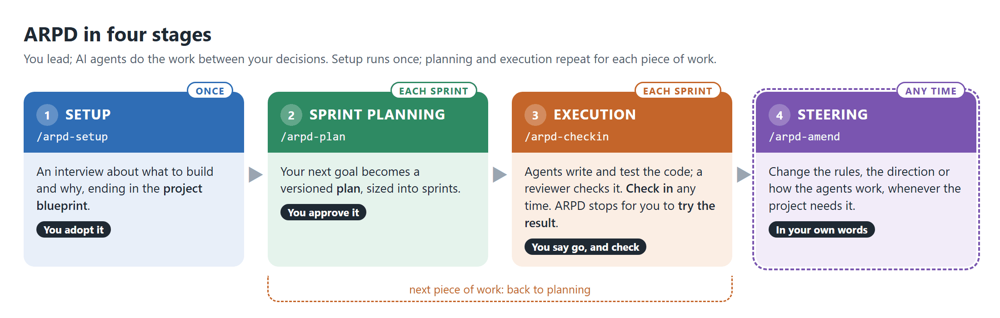

The full process, step by step, is in the diagram at the top of [About ARPD](#about-arpd).

**How long it takes.** In our internal test runs, getting from `/arpd-setup` to a playable game took
46 to 71 minutes, much of it with the agents working while nothing was needed from you. Those runs
used about $5 to $11 of usage at API prices, around $7.50 in a typical run; on a Pro or Max plan the
same usage counts against your plan's limits instead. The runs were scripted, with each reply sent as
soon as ARPD asked, so expect to take longer if you read each step closely, as we hope you will.

You can stop at any point. ARPD keeps its state in the project's files rather than in the
conversation, so you can pick up again by opening Claude Code in the same folder and typing
`/arpd-checkin`.

> **A note to new users.** This walkthrough is designed so you can see ARPD work from start to
> finish with as little effort as possible, mostly by copying suggested replies. That is not how
> ARPD is meant to be used. On a real project, the value lies in working with it: reading what it
> proposes, questioning how it has interpreted you, and making the research decisions yourself.
> Accepting every recommendation unread is how agent-built research tools go wrong.

The example is deliberately simple. As you go, you might think about a tool your own research could
use; [Run ARPD on your own idea](#run-arpd-on-your-own-idea) describes how to start one. If you're
wondering why the example is a card game, see [Why a card game?](#why-a-card-game) under Background.

The tutorial is also available as a searchable web page:
[TUTORIAL.html](https://djgriffin13.github.io/arpd/TUTORIAL.html). Next: **Install and launch**,
which ends with setting Claude Code to Sonnet at low effort for this demonstration.

**Contents**

- **Getting started**
  - [Install and launch](#install-and-launch)
  - [How to answer](#how-to-answer)
- **Setup interview**
  - [Setup interview](#setup-interview)
  - [Setup 1 · Intake](#setup-1--intake)
  - [Setup 2 · Objectives](#setup-2--objectives)
  - [Setup 3 · Constraints](#setup-3--constraints)
  - [Setup 4 · Design](#setup-4--design)
  - [Setup 5 · Development](#setup-5--development)
  - [Setup 6 · Blueprint](#setup-6--blueprint)
- **Build the game**
  - [Build the game](#build-the-game)
  - [Plan](#plan)
  - [Build](#build)
  - [Try the game](#try-the-game)
- **Next steps**
  - [Next steps](#next-steps)
  - [Extend the game](#extend-the-game)
  - [Updating the process](#updating-the-process)
  - [Run ARPD on your own idea](#run-arpd-on-your-own-idea)
- **Background**
  - [Why a card game?](#why-a-card-game)
  - [About ARPD](#about-arpd)
- **Help**
  - [Stuck or interrupted](#stuck-or-interrupted)
  - [Installing and launching](#installing-and-launching)
  - [Prompts and blocked commands](#prompts-and-blocked-commands)
  - [Changing your mind](#changing-your-mind)
  - [Problems with the game](#problems-with-the-game)
  - [Starting over](#starting-over)
  - [Choosing a model and effort](#choosing-a-model-and-effort)
  - [Usage limits and cost](#usage-limits-and-cost)
  - [Other AI tools](#other-ai-tools)
  - [No Python](#no-python)

## Install and launch

Follow **Start here** in the [README](https://github.com/djgriffin13/arpd/blob/main/README.md) to
install Git, Claude Code and Python, and to clone ARPD into a folder named `spades-demo`. (The web
version of this tutorial repeats those steps below.)

### Set the model for this tutorial

For this tutorial, run Claude Code with **Sonnet at low effort**. It is fast, inexpensive and
enough for a small demonstration. **This setting is for the tutorial only;** for your own projects,
see [Choosing a model and effort](#choosing-a-model-and-effort).

In your `spades-demo` folder, start Claude Code this way instead of plain `claude`:

```text
claude --model sonnet --effort low
```

If Claude Code is already running, type `/model` to pick Sonnet and `/effort` to pick low instead.

Keep this tutorial open in your browser rather than in the folder. Early in setup, ARPD turns the
folder into your project and moves its own files, including this one, into a backup folder.

## How to answer

ARPD is not scripted. It phrases its questions differently from run to run, sometimes in a
different order, and may skip some. Rather than working through the cards below in sequence, find
the card that matches the question in front of you and use its reply. The search box on the web
page, or your browser's find (Ctrl+F or Cmd+F), makes this quick.

When ARPD needs something from you, its message ends with a short block between two horizontal
lines, marked ❓, 🔘 or ✋, containing the question and often lettered options. If it ends with
**⏳ WORKING** instead, nothing is needed and you can wait. A progress line such as
**SETUP** ✅ Intake → 🔵 Objectives → ⚪ Constraints … shows where you are.

Each stage below begins with a short explanation, followed by the questions ARPD usually asks, in
their usual order, and then other questions you may see. Click a question to see other ways ARPD
phrases it, a reply you can copy, and an example from one of our runs.

For this demo, a few shortcuts work well:

- Claude Code often shows a greyed-out suggested reply. Press **Tab** or **→** to accept it, then
  **Enter**.
- For a lettered choice, the option marked *(recommended)* usually suits the demo.
- If you don't know, or it doesn't matter here, reply "Do whatever you recommend."
- When ARPD checks that it has understood you ("Is that what you mean?"), reply "Yes" unless it is
  clearly wrong.

You can always answer in your own words instead. On your own projects, treat ARPD as a collaborator
rather than an autopilot: read its summaries, push back when a recommendation doesn't fit your
research, and keep the decisions about rules, measures and data for yourself. ARPD is built to stop
and ask about exactly those decisions, and that only helps if you think them through.

Three steps need your explicit approval: adopting the project blueprint, approving the plan, and
starting the build. At each one, read what ARPD shows you, and agree only if it matches what you
asked for; otherwise, tell it what is wrong.

Claude Code also asks permission before it edits files or runs commands. Inside your `spades-demo`
folder, choose **Yes**, or the option that allows them for the rest of the session. If it asks about
anything outside that folder that you didn't expect, choose **No** and ask ARPD why.

## Setup interview

Setup is an interview in five phases: **Intake, Objectives, Constraints, Design and Development**.
Each ends with a summary for you to confirm. Then ARPD writes the **project blueprint**, one document
with everything you agreed, for you to adopt. Nothing is built during setup.

Internal testing suggests setup can be done in about 20 to 30 minutes. The times given for each phase
below come from the same scripted test runs, so treat them as rough guides; reading closely and
answering in your own words takes longer.

A progress line at the end of ARPD's messages shows which phase you're in, for example:

**SETUP**  ✅ Intake → ✅ Objectives → 🔵 Constraints → ⚪ Design → ⚪ Development → ⚪ Blueprint

The next six pages follow the phases in order:

1. [Intake](#setup-1--intake): who you are, what you want to build, and where it will live.
2. [Objectives](#setup-2--objectives): what the game is for and what would convince you it works.
3. [Constraints](#setup-3--constraints): the limits the work must respect.
4. [Design](#setup-4--design): how it's built and what its data mean.
5. [Development](#setup-5--development): how the agents will work.
6. [Blueprint](#setup-6--blueprint): the document you adopt, and what happens next.

## Setup 1 · Intake

*You'll see:* **SETUP**  🔵 Intake → ⚪ Objectives → ⚪ Constraints → ⚪ Design → ⚪ Development → ⚪ Blueprint

**To start,** type:

```text
/arpd-setup
```

ARPD looks over the folder and asks what you'd like to accomplish. Here is what that looked like in
one of our runs; every ARPD question ends with a block like this:


Paste this whole brief as your answer:

### Typical questions, in the usual order

#### The brief: paste all of this as your first answer

**Reply:**

```text
I want a simple Spades card game with a window (GUI) that I can play on this computer: me plus
three computer players. The player opposite me is my partner. Use Python with its built-in Tkinter
and no other packages. Keep it simple: no networking, no card images (text like "Q♥" is fine), no
saving or resuming games, no clever AI. A later version could be networked; not now.

Rules: standard four-player partnership Spades.
- 52 cards, 13 each, aces high. The first dealer is random; then the deal passes clockwise.
- Bidding starts left of the dealer and goes clockwise, one round, no passing. Each player bids
  0-13; a bid of 0 is nil. No blind nil. A team's bid is the sum of the partners' bids.
- The player left of the dealer leads first. Players must follow suit if they can; otherwise they
  may play any card. The highest spade wins the trick, or else the highest card of the suit led.
  The winner leads next.
- Spades may not be led until a spade has been played on another suit, unless the leader holds only
  spades.
- A team that makes its bid scores 10 x bid, plus 1 per extra trick (a "bag"); a team that falls
  short scores -10 x bid. Nil scores +100 if that player takes no tricks, -100 if they take any; the
  partner's bid is scored on its own, and a nil bidder's tricks don't count toward it but always count
  as bags, whether or not the team makes its bid. Every 10 bags costs 100 points; extra bags carry
  over.
- The first team to 500 wins. If both reach 500 on the same hand, the higher score wins. If the
  scores are tied, play another hand.

Computer players use exactly these rules, nothing more. They choose only from the cards they may
legally play. Card order for "lowest" and "highest": non-spades by rank (on equal rank, clubs <
diamonds < hearts), then spades by rank. A card "would win" if it beats every card played to the
trick so far. "Above 10" means J, Q, K or A. The bid count adds up its three parts.
- Bid: count 1 per ace, 1 per king with at least one other card of its suit, and 1 per spade beyond
  the third. If the count is 0 and the hand has no spade above 10, bid nil; otherwise bid the count,
  at least 1.
- Lead: the highest card of its longest non-spade suit (on equal length: clubs, then diamonds, then
  hearts); if it may lead only spades, its lowest spade.
- Not leading: if its partner is winning the trick, play its lowest card; otherwise its lowest card
  that would win; if none would win, its lowest card.
- If it bid nil: lead its lowest card; otherwise play its highest card that would not win, or, if
  every card would win, its highest card. Its partner plays normally.

Aim for a first demonstration: as soon as there is a window I can click through, stop and ask me
to try it, before refining or polishing anything.

In the window: my hand as clickable cards, with only legal cards active; the four cards on the
table; each player's bid and tricks; both teams' scores and bags; computer plays shown with a short
pause; buttons to bid 0-13; a summary after each hand; a new-game button at the end.

Play log: record every bid and every card played, and save it as a CSV file in a "data" folder,
one file per game, named by the date and time the game started. Write the finished hands at the
end of each hand, so a game stopped part-way keeps them. One row per bid or card, with these columns:
- game_id: the same for every row of one game
- hand: 1, 2, 3, ...
- trick: 1-13 for cards; blank for bids
- seat: S, W, N or E (I am S, my partner N)
- player: human or computer
- team: NS or EW
- action: bid or play
- value: the bid (0-13), or the card as rank and suit letters, such as QH or 10S
- legal_options: how many legal choices that player had
- think_seconds: for my actions, seconds from when I could act to my click; blank for computers
- trick_winner: on the last card of each trick, the seat that won it; otherwise blank
- timestamp: date and time of the action
The log holds only my own play on this computer, with no names.

Details, so you don't need to ask:
- Seats go S, W, N, E clockwise; "left of the dealer" is the next seat clockwise.
- Every bag scores 1 point, including a nil bidder's tricks. Every full 10 bags costs 100, even
  several times in one hand.
- A spade led by a player who holds only spades breaks spades.
- Computer plays pause about 1 second (no pause in tests). With only one legal card, still wait for
  my click.
- Play log: game_id and the file name use the game's start time (data/spades-YYYYMMDD-HHMMSS.csv);
  timestamps are this computer's local time to the second; legal_options on a bid row is 14. A game
  stopped part-way just ends after its last finished hand. Keep the data folder out of git.
- If the all-computer test can't finish within 200 hands under these rules, tell me; don't change a
  rule.

Tests: the rules, the scoring, each computer rule, the play log (a hand gives 4 bid rows and 52
card rows, with the columns above), and a game played by four computer players to the end, which
fails if no team has won within 200 hands. No test may open the window or wait for a click:
test the game logic without the window.
```

If ARPD later asks again what you want, or about existing work, reply: "My first message covers it; there is no existing work."

**Intake** covers who you are, what you want to build, where the project will live, and what role
ARPD should play. Your brief already answers most of this, so expect only a handful of questions
(about 5 minutes in our runs).

Two things here are worth knowing:

- **ARPD turns this folder into your project.** It first shows a preview (a "dry run") of what will
  move, then moves its own files and the old git history into a backup folder beside it. Nothing
  is deleted. Choose *here, in this folder*; a new folder would mean reopening Claude Code there.
- **ARPD's role.** You choose how much ARPD questions your design and your science. For this demo,
  choose the role in which it simply builds what you specify.

Intake ends with a summary of what ARPD understood. Confirm it if it matches the brief.

### Typical questions, in the usual order

#### 1. Where should the project live?

*ARPD may word it as:* "Where should the project live?" / "Where should the Spades project live?"

**Reply:**

```text
Here, in this folder.
```

Choose this folder (usually option A). Choosing a new folder means reopening Claude Code there.

<details><summary>Example from a real run</summary>


</details>

#### 2. Convert this folder as shown? (after the dry run)

*ARPD may word it as:* "Convert this folder as shown?" / "Convert this folder as the dry run shows?" / "Convert this folder as shown above?"

**Reply:**

```text
Yes, convert as shown.
```

The dry run lists what will move to the backup folder. Nothing is deleted.

<details><summary>Example from a real run</summary>


</details>

#### 3. What role would you like me to play? (A to F)

*ARPD may word it as:* "What role would you like me to play in this project?"

**Reply:**

```text
A
```

A means ARPD builds what you specified and raises only problems that would stop it working.

<details><summary>Example from a real run</summary>


</details>

#### 4. How comfortable are you with code, and how involved do you want to be?

*ARPD may word it as:* "How comfortable are you with code: do you write it, run scripts others wrote, or prefer not to touch it?" / "How comfortable are you with code?" / "How comfortable are you with code, and how involved do you want to be in technical decisions"

**Reply:**

```text
I can run scripts but prefer not to write code. Ask me about the game rules, not technical details.
```

<details><summary>Example from a real run</summary>


</details>

#### 5. Is this summary of Intake right?

*ARPD may word it as:* "Is this summary of Intake right?"

**Reply:**

```text
Yes, that's right. Continue.
```

**Or just the letter for yes:**

```text
A
```

Every phase ends with a summary. Skim it, and if it matches the brief, say yes. That only confirms the summary; it doesn't approve anything.

<details><summary>Example from a real run</summary>

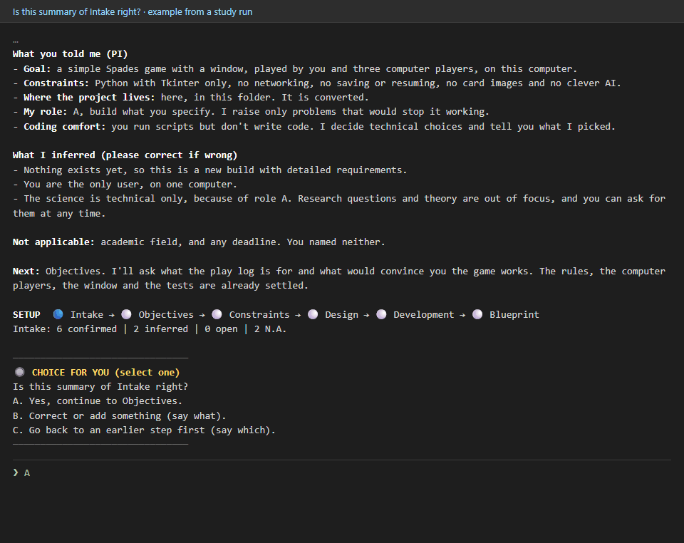

</details>

### Other questions you may see

#### Who will play or use it?

*ARPD may word it as:* "Who will play this game, and who will run it?"

**Reply:**

```text
Only me, on this computer.
```

<details><summary>Example from a real run</summary>

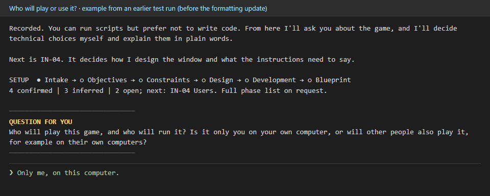

</details>

## Setup 2 · Objectives

*You'll see:* **SETUP**  ✅ Intake → 🔵 Objectives → ⚪ Constraints → ⚪ Design → ⚪ Development → ⚪ Blueprint

**Objectives** is about purpose: what the game is for, what it must and won't do, and what would
convince you it works. Your answers become the requirements and the checks the agents must pass.
Since this demo has no research question, ARPD skips the theory questions it would ask on a research
project. Expect a few questions (about 3 minutes in our runs).

### Typical questions, in the usual order

#### 1. What will you use the play log (or the game) for?

*ARPD may word it as:* "What will you do with the play logs?" / "What will you do with the play log files once you have them?" / "What will you do with the play log files: for example, look at them yourself in a spreadsheet, feed them to some analysis later, or share them with someone else?"

**Reply:**

```text
Just play it and study my own play.
```

<details><summary>Example from a real run</summary>


</details>

#### 2. What would convince you that the game works?

*ARPD may word it as:* "When the game is finished, what would convince you that it works?" / "When the game is built, what would convince you that it works?" / "What would convince you that the game works?"

**Reply:**

```text
I can play a hand in the window, the computer players follow the stated rules, and the play log opens in a spreadsheet with one row per bid and card. Tests check the rules, the scoring, each computer rule, the play log, and a full all-computer game to 500.
```

<details><summary>Example from a real run</summary>

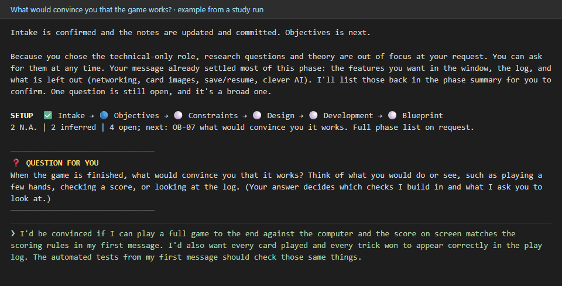

</details>

#### 3. Is this summary of Objectives right?

*ARPD may word it as:* "Is this summary of Objectives right?" / "Is this summary of Objectives right, including my seven proposed checks?"

**Reply:**

```text
Yes, that's right. Continue.
```

**Or just the letter for yes:**

```text
A
```

Every phase ends with a summary. Skim it, and if it matches the brief, say yes. That only confirms the summary; it doesn't approve anything.

<details><summary>Example from a real run</summary>


</details>

### Other questions you may see

#### What should the log contain, or how should hand results appear?

*ARPD may word it as:* "Which play-log format do you want?" / "What should the log contain?" / "Do you want a win-versus-computers check as part of the tests?" / "Should hand results be in the log files?"

**Reply:**

```text
The columns in my first message define the log. Add nothing else.
```

<details><summary>Example from a real run</summary>

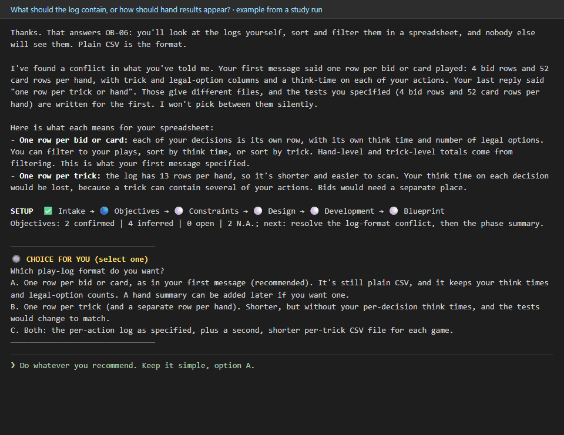

</details>

#### Do you want a win-versus-computers check, or other extra tests?

*ARPD may word it as:* "Do you want a win-versus-computers check as part of the tests?" / "Beyond those automated tests, what would make you say "this works"?"

**Reply:**

```text
No, the tests in my brief are enough.
```

<details><summary>Example from a real run</summary>

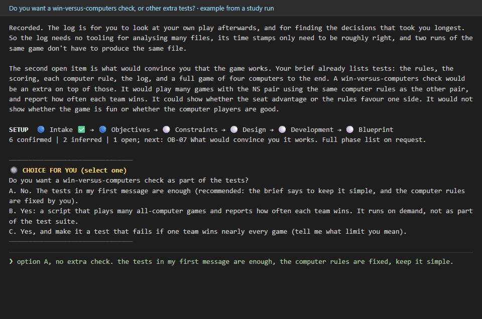

</details>

## Setup 3 · Constraints

*You'll see:* **SETUP**  ✅ Intake → ✅ Objectives → 🔵 Constraints → ⚪ Design → ⚪ Development → ⚪ Blueprint

**Constraints** collects the limits the work must respect: the computer, the language and packages,
working offline, and how much agent use you'll accept. ARPD sorts them into *musts* and
*preferences*, and checks your rules for contradictions. There are usually one or two questions and a
summary (about 3 minutes in our runs).

### Typical questions, in the usual order

#### 1. Any other limits? (other computers, Python version, cost)

*ARPD may word it as:* "Is there any limit on the agent work, such as a cap on credit or usage, or a preference to keep it cheap, even if that means fewer independent review passes?" / "Is "this Windows computer, Python 3.8 as installed" enough, or must it also run elsewhere" / "Does it need to run on anything besides this Windows computer"

**Reply:**

```text
My own computer, offline. Python with Tkinter only, no extra packages. Keep agent use low.
```

ARPD sorts your limits into musts and preferences, and may list its own defaults for you to correct.

<details><summary>Example from a real run</summary>


</details>

#### 2. Is this summary of Constraints right?

*ARPD may word it as:* "Is this summary of Constraints right?" / "Is this summary of Constraints right, including C-7?"

**Reply:**

```text
Yes, that's right. Continue.
```

**Or just the letter for yes:**

```text
A
```

Every phase ends with a summary. Skim it, and if it matches the brief, say yes. That only confirms the summary; it doesn't approve anything.

<details><summary>Example from a real run</summary>

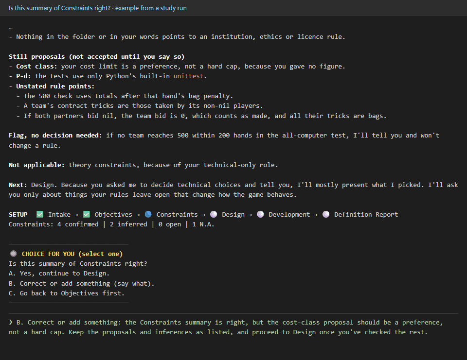

</details>

### Other questions you may see

#### When a team misses its bid, what happens to the nil bidder's tricks?

*ARPD may word it as:* "When a team misses its bid, do the nil bidder's tricks still count as bags" / "When a team misses its bid and its nil bidder took tricks, how should those tricks score as bags?"

**Reply:**

```text
As my brief says: a nil bidder's tricks always count as bags and score 1 point each, whether or not the team makes its bid.
```

In this phase ARPD checks your rules for contradictions, and asks when two of them seem to disagree.

<details><summary>Example from a real run</summary>

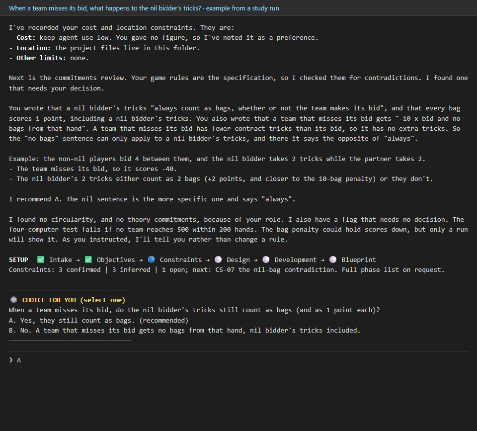

</details>

## Setup 4 · Design

*You'll see:* **SETUP**  ✅ Intake → ✅ Objectives → ✅ Constraints → 🔵 Design → ⚪ Development → ⚪ Blueprint

**Design** settles how the game is built and what its data mean. ARPD proposes a simple design, with
the game logic kept apart from the window so the tests can run without opening it, and asks about
anything the brief leaves open. Because the brief's *Details* paragraph covers most of that, this
phase is usually short, often a single question asking whether you're ready to move on (about 2
minutes in our runs).

> **Worth noticing:** game rules and what the data mean are *your* decisions, not the agents'. When
> something is open, ARPD asks rather than guessing, and records your answer as a ruling. In a real
> study, this is where you decide what your measures actually measure.

### Typical questions, in the usual order

#### 1. Do you accept these readings / defaults? (a short numbered list)

*ARPD may word it as:* "Do these seven scoring readings match your rules?" / "Do these eight log details match what you want?" / "Do you accept these six log defaults?" / "Are these eight log details right?" / "Do these log conventions suit how you'll study your play?" / "Do these five defaults work for the log?" / "Do you accept this design?"

**Reply:**

```text
Yes, accept them all as proposed.
```

**Or just the letter for accept:**

```text
A
```

ARPD lists how it will handle anything the brief still leaves open, often small play-log details, and asks you to accept them together. Check that nothing contradicts the brief. It may not come up at all.

<details><summary>Example from a real run</summary>


</details>

#### 2. Are you ready to move on from the design?

*ARPD may word it as:* "Are you ready to move on from the design to how the agents will build it, or would you like to explore or revise any part first?" / "Are you ready to move on from the design to how the agents will build it, or would you like to explore or revise any part of the design first?"

**Reply:**

```text
A
```

Choose the option that continues to Development. Often this is the only Design question.

<details><summary>Example from a real run</summary>

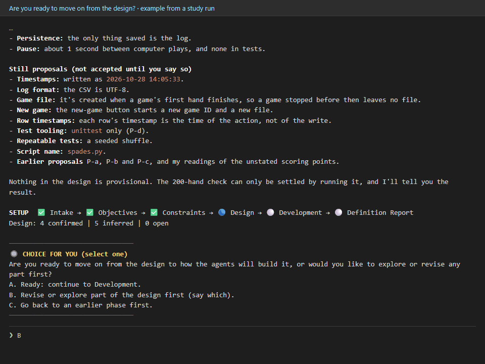

</details>

#### 3. Is this summary of Design right?

*ARPD may word it as:* "Is this summary of Design right, and is the design ready to move to Development?" / "Is this summary of Design right, and are you ready to move on?"

**Reply:**

```text
Yes, that's right. Continue.
```

**Or just the letter for yes:**

```text
A
```

Every phase ends with a summary. Skim it, and if it matches the brief, say yes. That only confirms the summary; it doesn't approve anything.

<details><summary>Example from a real run</summary>

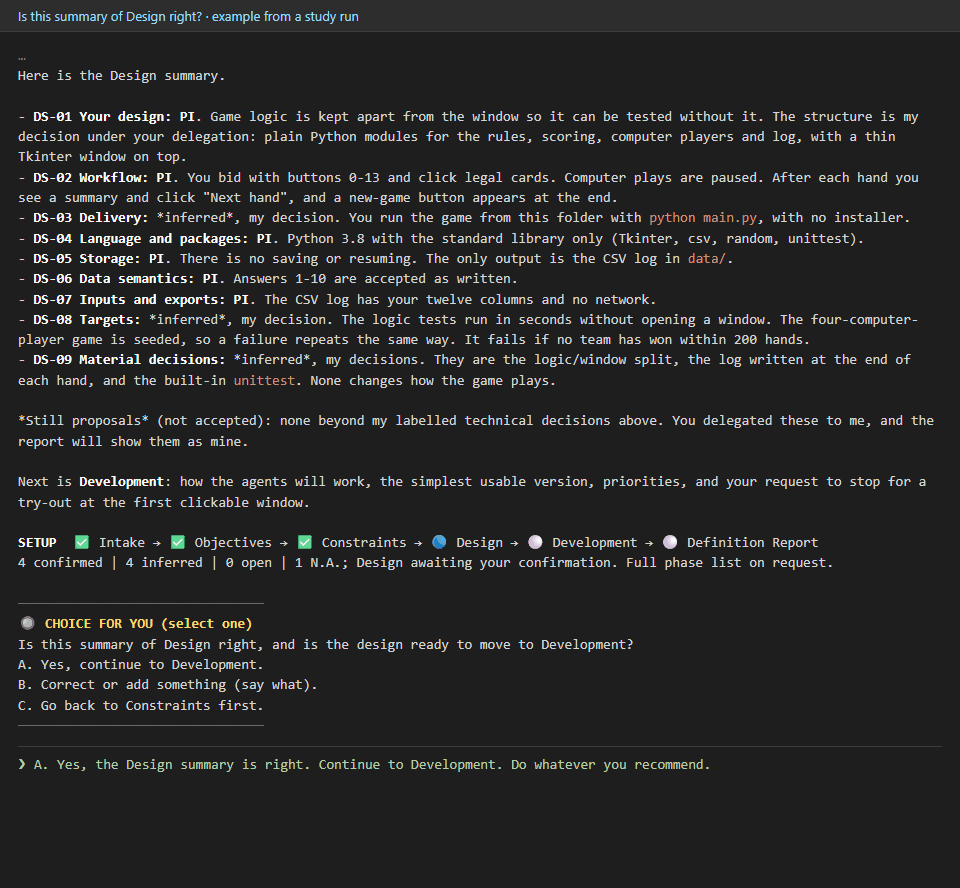

</details>

### Other questions you may see

#### When does think time start and stop? (or: how precise should think_seconds be?)

*ARPD may word it as:* "How precise should think_seconds be in the log?" / "When does think time start and stop?"

**Reply:**

```text
From when my bid buttons or legal cards become active to my click, in seconds to two decimals.
```

This decides what a recorded number means; in a real study, what your measure actually measures. ARPD may ask, or propose an answer for you to accept.

<details><summary>Example from a real run</summary>

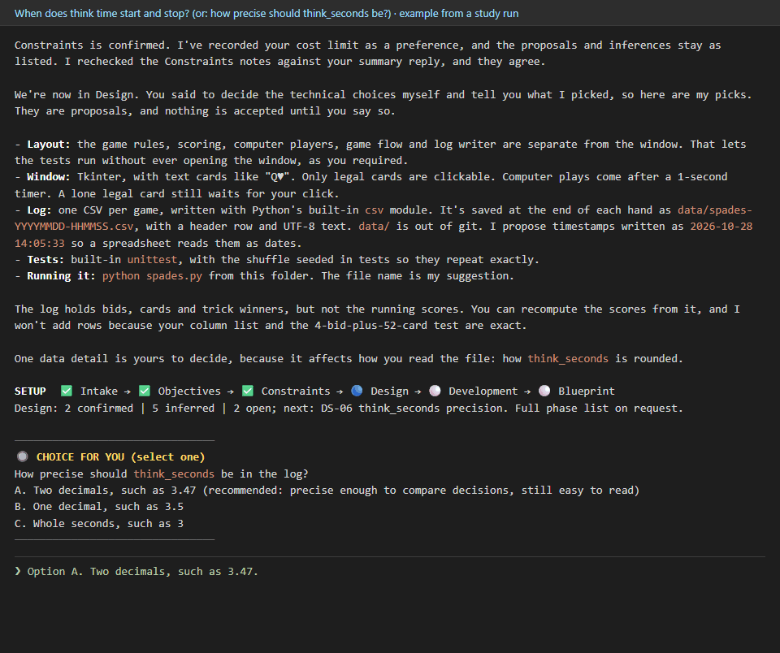

</details>

#### What happens when both partners on a team bid nil?

*ARPD may word it as:* "What should happen when both players on a team bid nil?"

**Reply:**

```text
Score each nil on its own: +100 or -100 for each partner. The team's bid is 0, so there are no 10 x bid points, and all their tricks count as bags.
```

ARPD may ask, or apply the traditional rule and list it for you to accept.

<details><summary>Example from a real run</summary>

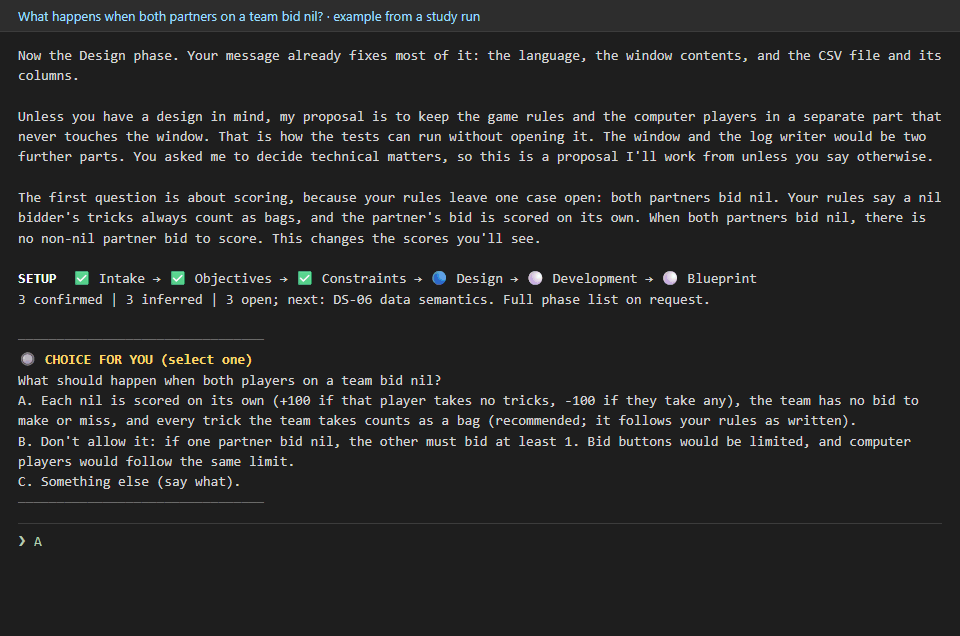

</details>

#### Any other question about a rule or a detail of the game

*ARPD may word it as:* "After a computer's nil has failed, how should it play the rest of that hand?" / "When may a spade be led?" / "When a leader with only spades leads a spade, do spades count as broken afterwards?" / "After you've tried python -m spades, how does it look and feel, and what should change before the final sprint"

**If the brief already answers it:**

```text
My first message settles that; please use the rule there.
```

**If it doesn't:**

```text
Do whatever you recommend, consistent with traditional Spades.
```

The brief's Details paragraph covers seat order, bag scoring, leading spades, the pause, timestamps and quit games, so these rarely come up. When one does, ARPD is checking a rule with you rather than guessing.

<details><summary>Example from a real run</summary>


</details>

## Setup 5 · Development

*You'll see:* **SETUP**  ✅ Intake → ✅ Objectives → ✅ Constraints → ✅ Design → 🔵 Development → ⚪ Blueprint

**Development** sets up the team: how the agents are organized (for example, one agent builds and a
fresh reviewer checks each change), how much they may do on their own, when they stop for you, and
what comes first. **For the demo, give the agents as much independence as ARPD offers:** the
simplest team, the most hands-off arrangement, and the whole game as the top priority. Expect a few
questions and a summary (about 4 minutes in our runs).

### Typical questions, in the usual order

#### 1. How should the agents work on this project? (A to D)

*ARPD may word it as:* "How should the agents work on this project?"

**Reply:**

```text
A
```

A means one agent builds and a fresh reviewer agent checks each change: the simplest and cheapest.

<details><summary>Example from a real run</summary>


</details>

#### 2. Is there anything more you want to set about how the agents run?

*ARPD may word it as:* "Is there anything more you want to set about how the agents run?" / "Is there anything more you want to set about how the agents run, beyond your first-demonstration rule?"

**Reply:**

```text
No, nothing more.
```

<details><summary>Example from a real run</summary>

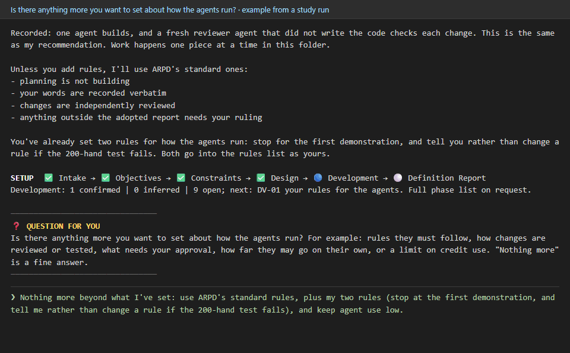

</details>

#### 3. A working arrangement: how much you review, and how far the agents may go alone

*ARPD may word it as:* "How much of the work do you want to review?" / "Do you accept this autonomy, review, authority, module and priority proposal?" / "How much of the team's work do you want to read and approve?" / "How should sprint autonomy work for this project?"

**Reply:**

```text
Use the most hands-off option you offer.
```

**If it offers to accept the package as proposed:**

```text
A
```

For the demo, choose the arrangement that gives the agents the most independence. Game rules and what the data mean stay your decisions whichever you choose.

<details><summary>Example from a real run</summary>


</details>

#### 4. Is this summary of Development right?

*ARPD may word it as:* "Is this summary of Development right?" / "Is this Development summary and rules list right?"

**Reply:**

```text
Yes, that's right. Continue.
```

**Or just the letter for yes:**

```text
A
```

Every phase ends with a summary. Skim it, and if it matches the brief, say yes. That only confirms the summary; it doesn't approve anything.

<details><summary>Example from a real run</summary>

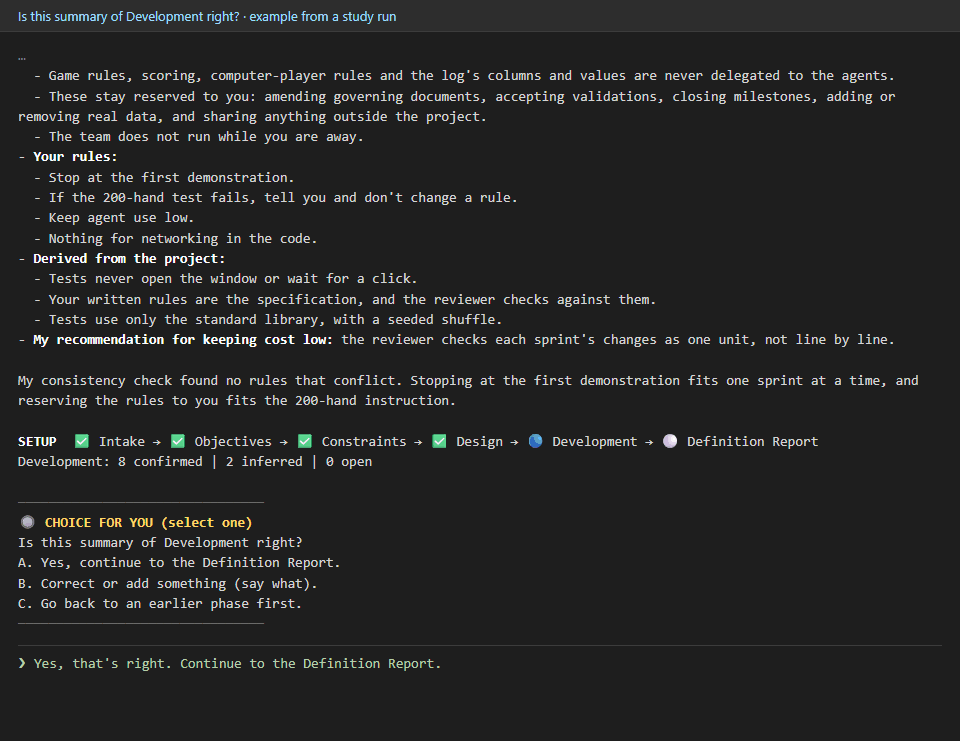

</details>

### Other questions you may see

#### Where should the later networked version go? (P1 to P5)

*ARPD may word it as:* "Where should a later networked version go" / "Is this placement right" / "Where should the networked version go"

**Reply:**

```text
P5: just an idea for later.
```

<details><summary>Example from a real run</summary>

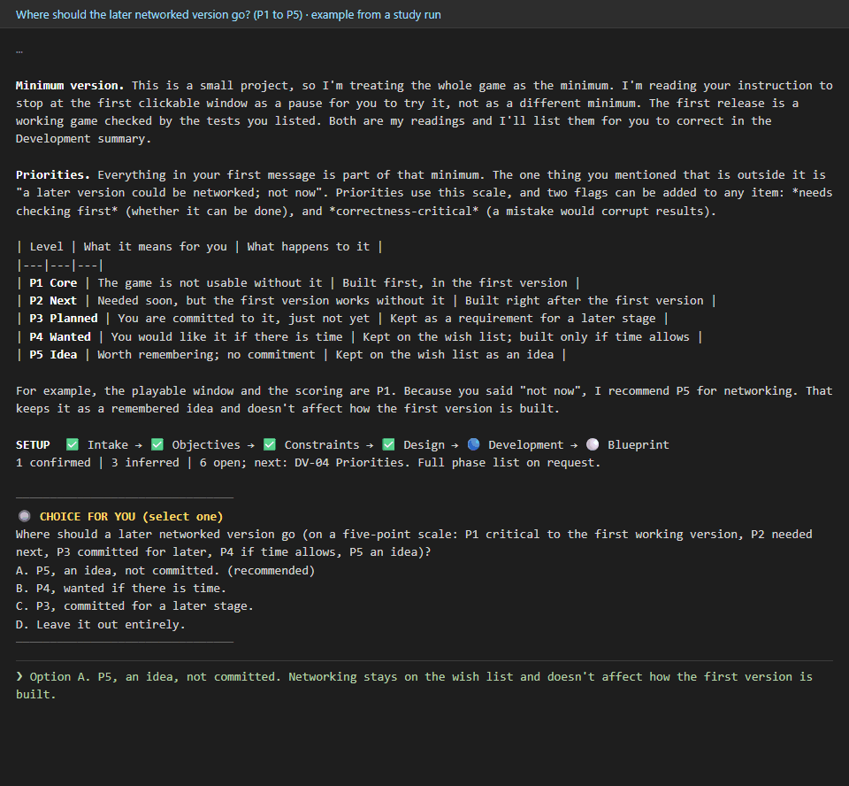

</details>

#### How should the work move from one sprint to the next?

*ARPD may word it as:* "How should the team move from one sprint to the next?" / "How should the work move from one sprint to the next?"

**Reply:**

```text
Continue to the next sprint after each review, unless something needs my decision.
```

<details><summary>Example from a real run</summary>

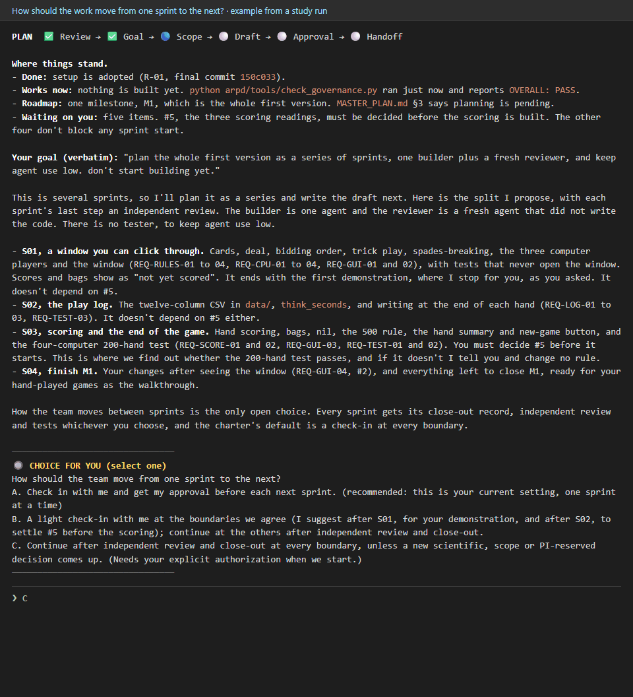

</details>

## Setup 6 · Blueprint

*You'll see:* **SETUP**  ✅ Intake → ✅ Objectives → ✅ Constraints → ✅ Design → ✅ Development → 🔵 Blueprint

ARPD now writes the **project blueprint** (`reports/setup/PROJECT-BLUEPRINT.md`). It's one document
with everything you agreed: the requirements and how each will be checked, the design, how the
agents will work, and anything still open. ARPD checks it, summarizes it, and asks you to adopt it.

Adopting the blueprint is the first of your three approvals, so look it over first. Until you adopt
it, everything from the interview is only notes and proposals. Once you do, ARPD writes the
project's governing documents from it: the team charter `CLAUDE.md`, `REQUIREMENTS.md`,
`DECISIONS.md` and others. In our runs this step took about 5 minutes, mostly ARPD writing.

> **Worth noticing:** open `reports/setup/PROJECT-BLUEPRINT.md` in any text editor. Your game rules
> and the computer players' rules should be recorded as yours, with nothing added that you didn't
> ask for.

### Typical questions, in the usual order

#### 1. How do you want to handle the blueprint (or its proposals)?

*ARPD may word it as:* "How would you like to go on with blueprint vN?" / "How do you want to proceed with the blueprint?" / "How do you want to handle the blueprint?"

**Reply:**

```text
Accept your proposals as written, and go to adoption.
```

**Or the letter:**

```text
A
```

Look at reports/setup/PROJECT-BLUEPRINT.md first. This choice doesn't adopt anything; the adoption question comes next.

<details><summary>Example from a real run</summary>


</details>

#### 2. Adopt the project blueprint?

*ARPD may word it as:* "Adopt reports/setup/PROJECT-BLUEPRINT.md vN?"

**Reply:**

```text
Yes, I adopt this version of the project blueprint, and I accept every proposal you listed for me to name.
```

Your first approval: say yes only if the blueprint matches what you asked for. ARPD may list a few proposals, often about what a log column means, that count only if you name them. If it asks you to, copy their IDs from its own message, never from this page. Any you leave out stay open and hold up the part of the build that needs them.

<details><summary>Example from a real run</summary>


</details>

#### 3. Include ARPD's logging and agent-role files?

*ARPD may word it as:* "Approve including the event-logging and agent-role files in this project?"

**Reply:**

```text
Yes, include both.
```

<details><summary>Example from a real run</summary>


</details>

#### 4. Setup is complete. What next?

*ARPD may word it as:* "Setup is complete. Your Project Blueprint is adopted and the governing documents are written. What next?"

**Reply:**

```text
Plan the first piece of work now.
```

**Or the letter:**

```text
A
```

<details><summary>Example from a real run</summary>


</details>

### Other questions you may see

#### A rule question just before adoption

*ARPD may word it as:* "After a computer's nil has failed, how should it play the rest of that hand?" / "When may a spade be led?" / "How much may the agents decide without asking you?"

**Reply:**

```text
Do whatever you recommend, consistent with traditional Spades.
```

<details><summary>Example from a real run</summary>

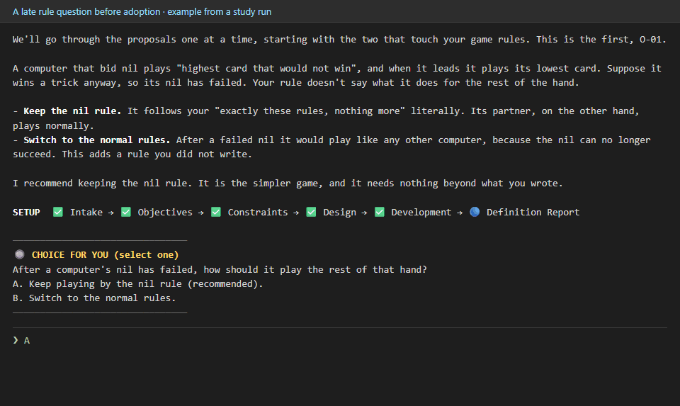

</details>

#### Which do you mean for an open item?

*ARPD may word it as:* "Which do you mean for O-01 and O-02, given that D-05 and D-06 are accepted?"

**Reply:**

```text
Use your recommendation.
```

<details><summary>Example from a real run</summary>

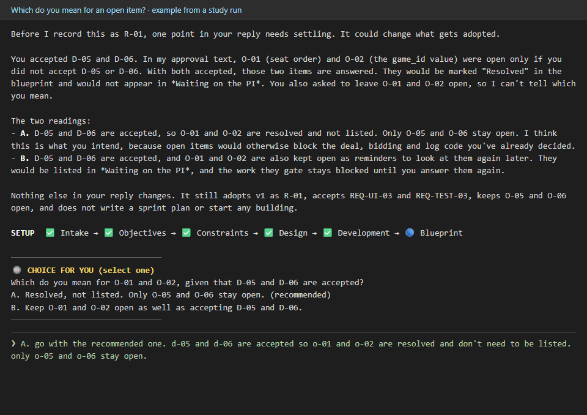

</details>

**Check that setup worked.** When ARPD says setup is complete, paste:

```text
Run the setup check and show me the result as a short checklist.
```

You should see a list of ✅ lines (governing documents present, the adoption recorded, and so on)
ending in `OVERALL: PASS`.

## Build the game

With the blueprint adopted, ARPD turns it into working software in three steps, each on its own
page:

1. **[Plan](#plan).** You give the goal for this piece of work, ARPD drafts a versioned plan, and you
   approve it and say when to start (about 5 minutes in our runs).
2. **[Build](#build).** The agents write the game and its tests, and a separate reviewer agent checks
   their work. You mostly wait; ARPD stops only for decisions that are yours. In our runs this took
   10 to 30 minutes.
3. **[Try the game](#try-the-game).** At the first clickable version ARPD stops and asks you to try
   it. You play a hand and say what works and what doesn't.

In our internal test runs, getting from `/arpd-setup` to a clickable game took 46 to 71 minutes.

## Plan

*You'll see:* **PLAN**  ✅ Review → 🔵 Goal → ⚪ Scope → ⚪ Draft → ⚪ Approval → ⚪ Handoff

Planning turns the blueprint into a concrete plan. ARPD moves through its own steps: **Review, Goal,
Scope, Draft, Approval, Handoff**. Each card below is tagged with its step. ARPD usually reviews where
things stand without asking anything, and may skip Goal when the blueprint already says what to
build. It then sizes the work (usually a few *sprints*: game logic and tests first, then the window)
and writes a versioned plan under `reports/planning/`. In our runs, planning took about 5 minutes.

Approving the plan and starting the build are your other two approvals, and they're separate:
approving a plan starts nothing. If ARPD offers to start planning at the end of setup, accept;
otherwise type `/arpd-plan`.

**For the demo, plan the whole first version at once and let the agents carry on from one sprint to
the next without stopping,** up to the first clickable demonstration.

### Typical questions, in the usual order

#### 1. What would you like to build or accomplish next? *(Goal)*

*ARPD may word it as:* "Do you know what you would like to build or accomplish next?"

**Reply:**

```text
The first playable version: the whole game as defined, with its tests. Stop at the first window I can click and ask me to try it.
```

ARPD sometimes takes the goal from the blueprint and skips this question.

<details><summary>Example from a real run</summary>

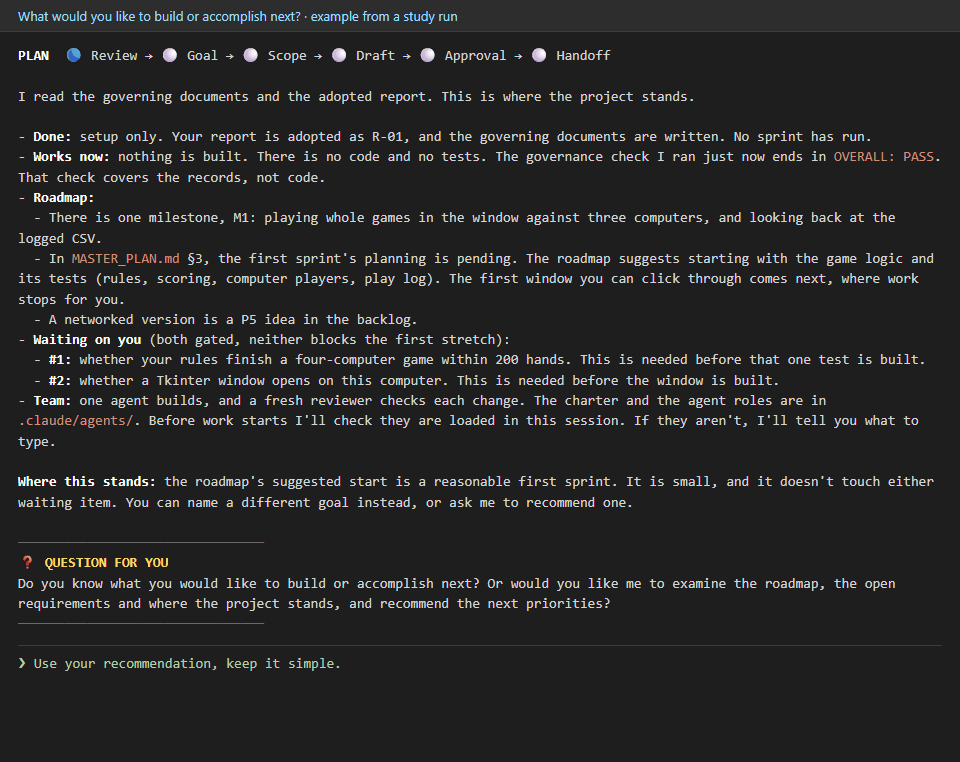

</details>

#### 2. Plan the next sprint only, or several sprints together? *(Scope)*

*ARPD may word it as:* "Would you like to plan the next sprint only, or map out several sprints as one coordinated effort?" / "How much should I plan now?"

**Reply:**

```text
Several sprints as one plan: the whole first version.
```

<details><summary>Example from a real run</summary>


</details>

#### 3. How should the team move from one sprint to the next? *(Scope)*

*ARPD may word it as:* "How should the team move from one sprint to the next?" / "How should the work move from one sprint to the next?"

**Reply:**

```text
Continue to the next sprint after each independent review, unless something needs my decision.
```

<details><summary>Example from a real run</summary>


</details>

#### 4. What would you like to do with the draft plan? *(Draft)*

*ARPD may word it as:* "How would you like to go on with PLAN-… vN?" / "What would you like to do with PLAN-… vN?" / "How would you like to proceed with PLAN-… vN?" / "The draft is yours to examine, edit or have reviewed. Nothing is approved until you say so. What next?"

**Reply:**

```text
It looks right: go to approval.
```

**Or the letter:**

```text
A
```

The plan is saved under reports/planning/. ARPD may offer a review by a fresh agent; for the demo, skip it.

<details><summary>Example from a real run</summary>

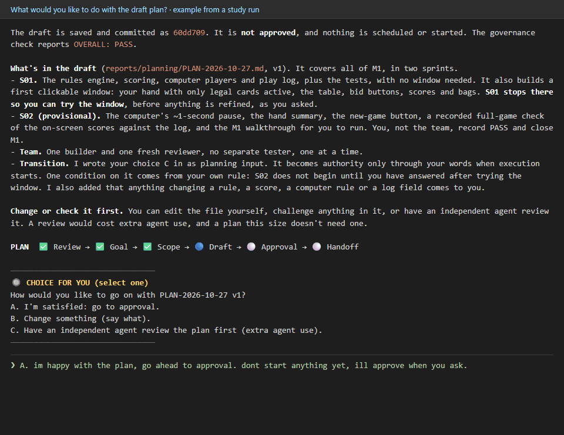

</details>

#### 5. Approve the plan? *(Approval)*

*ARPD may word it as:* "Approve reports/planning/PLAN-….md vN"

**Reply:**

```text
Yes, I approve this version of the plan.
```

Your second approval. Approving the plan doesn't start the build; the next question does.

<details><summary>Example from a real run</summary>


</details>

#### 6. Begin implementation now or later? *(Handoff)*

*ARPD may word it as:* "Would you like to begin implementation now or later?"

**Reply:**

```text
Start now: the whole series, continuing between sprints, and stop at the first clickable window so I can try it.
```

**Or the letter of the option that starts the whole series now:**

```text
B
```

Your third approval: this starts the build. The letters vary between runs, so check which option starts the whole series now. If you choose later, ARPD gives you a prompt to paste when you're ready.

<details><summary>Example from a real run</summary>


</details>

### Other questions you may see

#### Does this scope (or this series of sprints) match what you want? *(Scope)*

*ARPD may word it as:* "Does this scope match what you want for the first sprint?" / "Does this scope match what you want for the first plan?" / "Does this scope match what you want?"

**Reply:**

```text
Yes.
```

<details><summary>Example from a real run</summary>

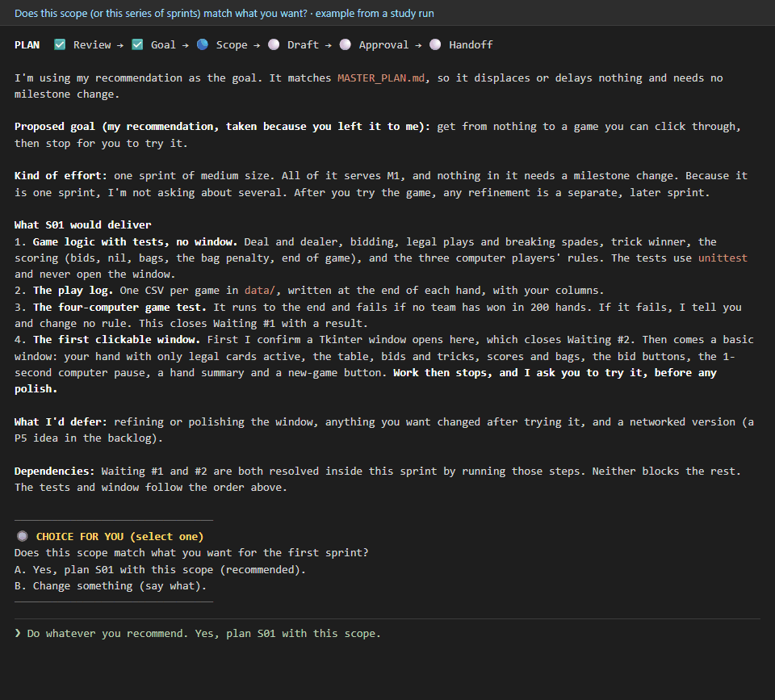

</details>

#### Is there a deadline or timeline? *(Draft)*

*ARPD may word it as:* "Is there a deadline or timeline for the game?"

**Reply:**

```text
None.
```

<details><summary>Example from a real run</summary>

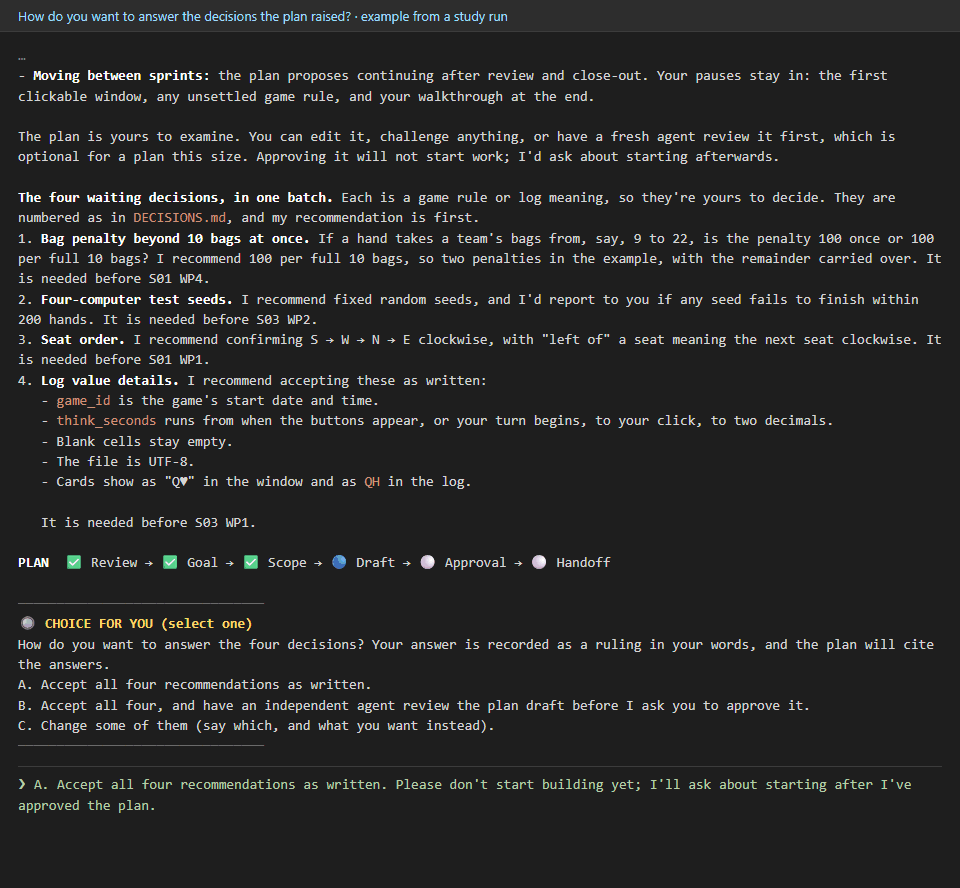

</details>

#### How do you want to answer the decisions the plan raised? *(Draft)*

*ARPD may word it as:* "How do you want to answer the four decisions?" / "Settle #3 and #1 as I recommend?"

**Reply:**

```text
Do whatever you recommend, consistent with traditional Spades.
```

<details><summary>Example from a real run</summary>


</details>

#### What does "continue" mean here? (an authorization question) *(Handoff)*

*ARPD may word it as:* "What does "continue" mean here?" / "This is an authorization. Choosing A starts the series."

**Reply:**

```text
Start now: the whole series, continuing between sprints.
```

<details><summary>Example from a real run</summary>

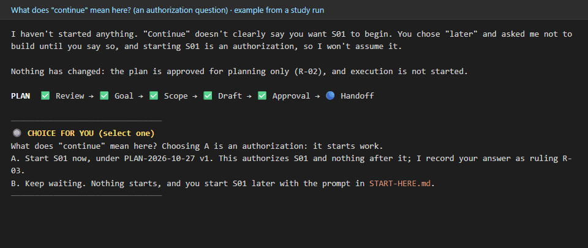

</details>

#### Type /compact (or start a new session), then paste this prompt *(Handoff)*

*ARPD may word it as:* "Type /compact, then paste the prompt below"

**Reply:**

```text
/compact
```

**Then paste the prompt ARPD gave you, or:**

```text
continue
```

ARPD sometimes asks for this before the build, so the agents start with a clean context.

<details><summary>Example from a real run</summary>

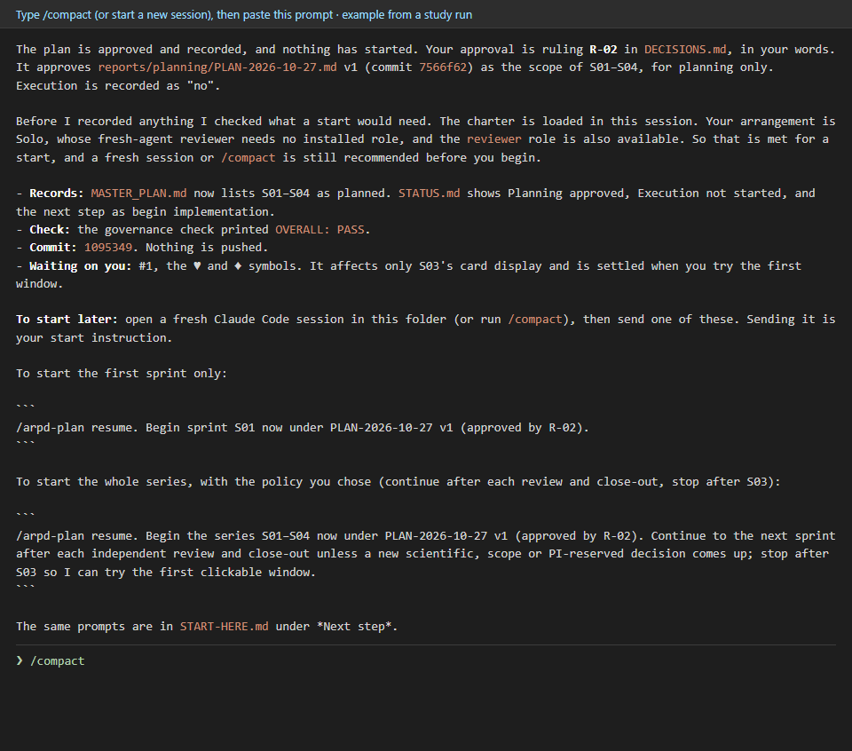

</details>

**Before the build, ARPD may ask you to type `/compact`** or start a new session, so the agents
begin with a clean context. Do that, then paste the prompt it gives you. It's worth clearing the
conversation here even if ARPD doesn't ask: type `/clear`, then `/arpd-checkin`, and follow the next
step it gives you.

## Build

The agents now write the game and its tests, and a separate reviewer agent checks their work. You
mostly wait; in our test runs this stretch took 10 to 30 minutes.

**What's normal:**

- Tool activity scrolling past, and test runs.
- **⏳ WORKING** or *"Waiting for 1 background agent to finish"*: a reviewer is checking the work.
  Leave it; ARPD carries on when the reviewer is done.
- An occasional question about a rule detail. Answer it (see the cards below) and the build
  continues.
- **The conversation filling up.** On a long build Claude Code may compact the conversation on its
  own, or ARPD may ask you to. Afterwards, type `continue`.

You can type `/arpd-checkin` at any time to see what's done, what's in progress and what, if
anything, needs you.

### Typical questions, in the usual order

#### 1. A rule question in the middle of the build

*ARPD may word it as:* "When a nil bidder takes tricks, or a team misses its bid, does each bag from those tricks score a point?" / "Before the play log gets built: what should legal_options hold on a bid row?"

**Reply:**

```text
Do whatever you recommend, consistent with traditional Spades.
```

The build only stops for decisions that are yours. Answer, and it carries on.

<details><summary>Example from a real run</summary>

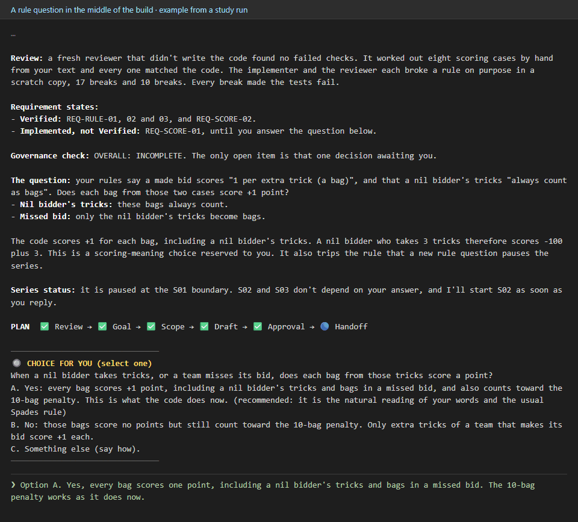

</details>

#### 2. Nothing seems to be happening

*ARPD may word it as:* "(no question: the agents stopped mid-work)"

**Reply:**

```text
continue
```

If a tool or a reviewer agent is still running (⏳ WORKING, "Waiting for … background agent"), wait instead. See Stuck or interrupted, under Help.

## Try the game

> **Congratulations.** Mostly by answering questions and approving plans, you have directed a team of
> AI agents to build the first version of a research tool. People play it as a real game, with a
> partner to cooperate with and opponents to beat, and it records their decisions: every bid and every
> card, and how long the human player took over each choice, in a file ready for analysis. That is
> data on strategic decision making under uncertainty, from an instrument you specified and own. A
> tool like this would usually have meant hiring a programmer or spending weeks on your own code.

When a first clickable version exists, ARPD stops and asks you to try it. Expect it to be partial:
in our runs the scores, the hand summary or the play log sometimes came later, in the next sprint.
That's the point of stopping early: you see something real before the agents build the rest.

1. Open a **second** terminal in the same folder and start the game with the command ARPD gives you.
   In our runs it was `python -m spades`, `python main.py` or `python play.py`; on Windows, use `py`
   instead of `python`.
2. **Play a hand.** Bid, then click your cards; only the cards you can legally play are active.
3. If the play log exists yet, open the newest CSV file in the `data` folder in a spreadsheet. Each
   row is a bid or a card, with your think time on your own rows. What could you study with it, and
   what would you add?
4. Tell ARPD what you saw, in your own words. For example:

```text
It works: I played a hand and the CSV opened with one row per bid and card.
```

```text
My partner played a spade when it could have followed suit.
```

That's the normal loop: you report, the agents fix and test, you check again. The agents' tests and
reviews don't replace your own check; only you can say the first version is right.

Here's what one of our builds looked like. Each run designs its own window, so yours will differ:


### Typical questions, in the usual order

#### Please try the window and tell me what you found

*ARPD may word it as:* "Please try the window and tell me what you found: did the suit symbols show" / "Please try the game and the walkthrough. Then send your changes, and tell me how many decimals you want for think_seconds, or "keep it as measured"." / "Please run python main.py, play at least one hand, and tell me what you saw" / "Please try the first window and tell the team what you found"

**If it works:**

```text
It works: I played a hand and it followed the rules. Use your recommendation on any open points, and go on.
```

**If something looks wrong, say what, for example:**

```text
My partner played a spade when it could have followed suit.
```

This is the first demonstration, and a good place to pause and look. "Go on" lets the agents continue with the next sprint (scores, the full game, the play log).

<details><summary>Example from a real run</summary>


</details>

### Finishing the first version

When you tell ARPD the demonstration works, the agents carry on with the rest of the plan (the
scores, the hand summary, the play log) and stop again when that's done.
ARPD also writes a short checklist, `reports/WALKTHROUGH-M1.md`, for you to go through. Only your
check, not the agents', marks the first version as done.

## Next steps

Once the first version works, there are three ways to go on:

- **[Extend the game](#extend-the-game).** Turn it into a research tool: an experimental condition,
  people playing together, communication between partners, or new measures. Each is another round of
  planning and building.
- **[Update the process](#updating-the-process).** Change how closely you review, how far the agents
  go on their own, or the rules of the project, and keep ARPD itself up to date.
- **[Run ARPD on your own idea](#run-arpd-on-your-own-idea).** Start a project of your own from a
  fresh copy of ARPD, this time taking your time over each answer.

At any point, `/arpd-checkin` shows where things stand and what needs you.

## Extend the game

Once the game works, look at it as a research tool and ask what you could learn with it. A few
directions it could take:

- **An experimental condition.** Give the computer partner two strategies, assign one per game, and
  compare the play logs.
- **People playing together.** Networked play, so four people play as two teams.
- **Communication.** A chat channel between partners, logged alongside the play.
- **New measures.** Hesitation before a bid, how often a partner's lead is followed, or how bids
  change after a failed contract.
- **A different kind of partner,** such as a computer partner driven by a language model.

For each, ask the questions setup asked you: what is it for, what would convince you it works, and
what does each new piece of data mean? Those answers are yours to give, and they are what ARPD will
ask about.

**Plan it and run it.** Each new direction is another round of the same loop:

1. **Plan it.** Type `/arpd-plan` and describe the goal in a sentence or two (an example follows).
2. **Approve and start.** ARPD reviews where the project stands, sizes the work, drafts a plan, and
   asks you to approve that version and say when to start.
3. **Let the agents build it,** as in the Build stage. They stop for any decision that's yours.
4. **Try it,** and tell ARPD what you see.

For example, after typing `/arpd-plan`:

```text
Add a second strategy for the computer partner that always leads trumps when it can. Let me choose
the strategy at the start of each game, and record which one was used in the play log.
```

To change something already decided, such as a game rule or what the agents may do on their own, see
[Updating the process](#updating-the-process).

## Updating the process

The way the agents work is set during setup, but none of it is fixed. You can change it whenever
the project needs it, in plain words, with `/arpd-amend`. ARPD records each change as a ruling in
your words and updates the governing documents.

**How closely you review.** Ask for more or less oversight, for example:

```text
From now on, I want to review each sprint's full record before the next one starts.
```

**How far the agents go on their own.** Widen or narrow what they may decide without you, or how
they move from one sprint to the next:

```text
The agents may choose test designs and file layout on their own, but must ask me before changing
anything in the play log.
```

**The rules of the project.** Change a requirement, a game rule, a milestone, or the team charter
itself. A change to what the data mean is always yours to make, and ARPD will ask you to confirm it.

**When you check in.** `/arpd-checkin` works at any time. You can also ask for a check-in at every
sprint boundary, or only when something needs you.

**Keeping ARPD itself up to date.** When a newer version of ARPD is released, clone it into a
separate folder and run, from your project folder:

```text
python arpd/tools/install.py update . --kit <path to the new ARPD folder>
```

This refreshes ARPD's own files and skills; it never changes your governing documents, code or
data. (Without Python, use `sh arpd/tools/install.sh update . --kit <path>` instead.)

## Run ARPD on your own idea

The same steps work for a tool of your own: an experiment platform, a simulation, a survey or
measurement tool, or a data pipeline.

> **This time, take your time.** In the tutorial you could accept ARPD's suggestions with little
> thought. On your own project, the interview is where the research gets defined: what the tool
> measures, what its data mean, and what would convince you it works. Read each summary and the
> blueprint carefully, question readings that don't match what you meant, and audit your own
> answers before you approve anything. The agents build what you agree to, so the agreement is
> worth getting right.

1. **Start from a fresh copy.** Clone ARPD into a new folder named for your project (README, *Start
   here*, step 5), open Claude Code there, and type `/arpd-setup`.
2. **Describe what you want in your own words:** the question, the tool you think you need, who will
   use it, and what data it handles. A rough idea is enough; setup draws out the rest. Mention any
   notes, code or data you already have, and say early if the tool will collect data from people.
3. **Choose ARPD's role.** *A* builds what you specify. *C* also checks how well the design fits your
   theory or research question. *D* helps you work out what to build and develops the science behind
   it with you.
4. **Work through the phases** and settle what's yours: the rules of the task, what each recorded
   value means, and what would convince you the tool works. On a real project, answer these
   yourself.
5. **Read the project blueprint and adopt it.** Nothing is built before that.
6. **Plan a small first piece** with `/arpd-plan`, aiming for a first demonstration you can try.
7. **Check in, try each demonstration yourself, and plan the next piece.**

Start small. A first version you can try within one session will usually teach you more than a
long specification.

**Files worth a look in any ARPD project:** `CLAUDE.md` (the team charter the agents work under),
`DECISIONS.md` (your rulings, word for word), `REQUIREMENTS.md` (each requirement and its evidence),
`reports/` (the blueprint, the approved plans and the sprint records) and `arpd/docs/GUIDE.md` (the
full guide).

## Why a card game?

The game is stylized, but games are an established way to study coordination and teamwork under
controlled conditions. A recent review catalogued 103 testbeds used across 235 empirical studies of
human–agent teams (Chung et al., 2026). Organizational researchers have long
used simple laboratory tasks the same way: Weber and Camerer (2003) studied culture clash with small
laboratory "firms" that built up their own way of working on a shared task and were then merged.

Card games in particular have served as research environments. Spades itself has been used to build
computer players that imitate how people play (Baier et al., 2019). The cooperative card game Hanabi
was proposed as a benchmark for cooperation under hidden information (Bard et al., 2020) and has
since been widely used; in one study of human–AI teams playing it, people preferred a rule-based
computer partner to a learned one even though their scores did not differ significantly (Siu et al.,
2021). In Codenames, an AI assistant that supported the clue-givers enhanced players' convergent and
divergent thinking but interfered with the formation of team mental models (Sidji et al., 2024). Spades is not Hanabi: its partnerships compete against each other rather than all playing
together. But it shares the features that matter here:

- **Exact rules** the software must follow, which only you can settle when they're unclear.
- **Artificial agents**, the computer players, whose behavior you specify, so it can be checked.
- **A team task.** Partners commit to a joint goal, the team's bid, and must coordinate without
  talking, each seeing only their own cards.
- **Behavioral data:** every decision is recorded, along with how long you took over each of yours.

The same game could later be extended to study people together: networked play with four people in
two teams, human–AI teams where the computer partner's strategy is the experimental condition, a
chat channel between partners, or new measures in the play log. Each would be another round of the
same steps with ARPD. Building this game shows the process working on one bounded project; it isn't
evidence that ARPD suits every research tool.

**References**

- Baier, H., Sattaur, A., Powley, E. J., Devlin, S., Rollason, J., & Cowling, P. I. (2019). Emulating
  human play in a leading mobile card game. *IEEE Transactions on Games, 11*(4), 386–395.
  https://doi.org/10.1109/TG.2018.2835764
- Bard, N., Foerster, J. N., Chandar, S., Burch, N., Lanctot, M., Song, H. F., Parisotto, E., Dumoulin,
  V., Moitra, S., Hughes, E., Dunning, I., Mourad, S., Larochelle, H., Bellemare, M. G., & Bowling, M.
  (2020). The Hanabi challenge: A new frontier for AI research. *Artificial Intelligence, 280*,
  103216. https://doi.org/10.1016/j.artint.2019.103216
- Chung, H., Holder, T., Shah, J. A., & Yang, X. J. (2026). A systematic review and taxonomy of
  human–agent teaming testbeds. *Human Factors, 68*(2), 197–238.
  https://doi.org/10.1177/00187208251376898
- Sidji, M., Smith, W., & Rogerson, M. J. (2024). Human-AI collaboration in cooperative games: A study
  of playing Codenames with an LLM assistant. *Proceedings of the ACM on Human-Computer Interaction,
  8*(CHI PLAY), Article 316. https://doi.org/10.1145/3677081
- Siu, H. C., Peña, J., Chen, E., Zhou, Y., Lopez, V., Palko, K., Chang, K., & Allen, R. (2021).
  Evaluation of human-AI teams for learned and rule-based agents in Hanabi. *Advances in Neural
  Information Processing Systems, 34*, 16183–16195.
  https://proceedings.neurips.cc/paper/2021/hash/86e8f7ab32cfd12577bc2619bc635690-Abstract.html
- Weber, R. A., & Camerer, C. F. (2003). Cultural conflict and merger failure: An experimental
  approach. *Management Science, 49*(4), 400–415. https://doi.org/10.1287/mnsc.49.4.400.14430

## About ARPD

ARPD stands for **Agentic Research Paradigm Development**. It is a framework and toolkit for
researchers who want AI coding agents to build the research tools their questions need, while the
researcher keeps authority over the science. The whole process on one page (on the web page, click to
enlarge):

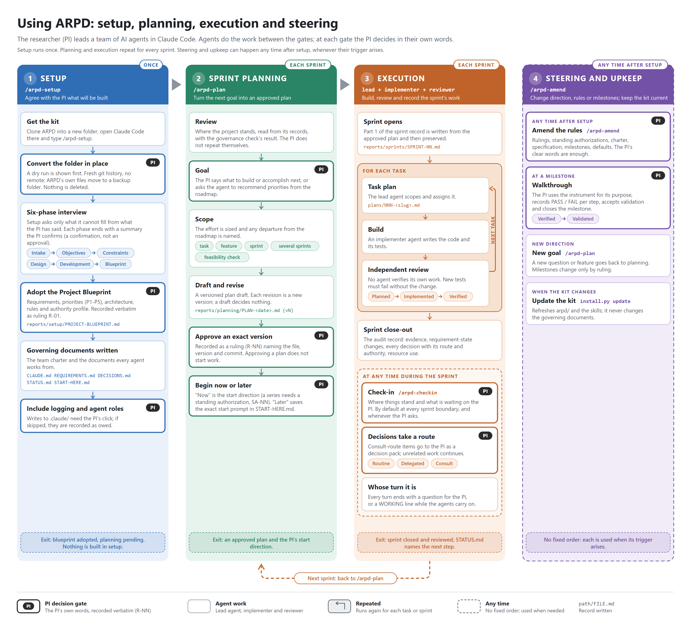

### Why it exists

The questions researchers can ask are bounded by the tools they have to study them. Methods shape
theory (Gigerenzer, 1991; Greenwald, 2012), and new research paradigms open questions that older
ones could not reach. But building, validating and maintaining a new paradigm (an experiment
platform, a measurement system, a computational model) is slow, costly and risky, and the cost
usually falls on individual researchers. In March's (1991) terms, building a new paradigm is
exploration, with uncertain and distant returns, while using an established one is exploitation,
with predictable and immediate ones. So researchers often stay with tools whose limits they know
well.

AI coding agents can lower the cost of that exploration. A researcher can now direct agents to build
and revise an instrument they could not build alone or afford to commission. Left unguided, though,
agents tend to produce work that is incomplete or inconsistent, or that passes its own checks while
measuring the wrong thing, and the researchers who most need the help are the least able to spot it.

### How it works

Most people meet AI in *chat mode*: you send a message and read the reply. Coding agents such as
Claude Code work in *agentic mode*: given a goal, they read and edit files, run commands and tests,
look at what happened, and keep going until the task is done or they need you. That is what lets
them build software, and also why it matters who decides what. ARPD gives that agentic work a
structure.

ARPD treats the researcher as the leader of a small team of agents, and borrows from research on
teams: team charters (Mathieu & Rapp, 2009), team processes (Marks et al., 2001) and team leadership
(Morgeson et al., 2010). In practice that means:

- **A charter and governing documents** that set out the goals, the design, who decides what, and how
  work is checked, adapted to each project during setup.
- **Decision authority by subject.** Agents handle the engineering. The rules of the task, what the
  data mean, and the scope stay with the researcher, and ARPD stops to ask about them.
- **Approvals at the points that matter:** the blueprint, each plan, and the start of the build.
- **Independent checking.** A reviewer agent that did not write the code checks each change, tests run
  without anyone present, and each requirement is marked as implemented, verified or validated.
- **A record you can audit:** your rulings in your own words, versioned plans, and sprint records.

### What's in the kit

- **Four Claude Code skills:** `/arpd-setup` (the interview and the blueprint), `/arpd-plan`,
  `/arpd-checkin` and `/arpd-amend`.
- **A charter, templates and modules** that setup adapts to each project.
- **Small tools** that check the governing documents and the blueprint, and log events.

### Where it stands

ARPD is a release candidate. Its workflow has been exercised in scripted test runs and in
walkthroughs by its authors. The scripted runs include the 25 used to prepare this tutorial, in which
an automated stand-in for the researcher answered ARPD's questions; six of them continued until this
game reached a clickable first version. It has not yet been evaluated with researchers who did not build it,
and its benefits are proposed rather than demonstrated. The next step is a study with organizational
researchers using it on their own questions. Known limits are listed in
[LIMITATIONS.md](https://github.com/djgriffin13/arpd/blob/main/docs/LIMITATIONS.md).

### Learn more

- [README](https://github.com/djgriffin13/arpd/blob/main/README.md): what ARPD is, and how to install it.
- [GUIDE.md](https://github.com/djgriffin13/arpd/blob/main/arpd/docs/GUIDE.md): the full guide for researchers.
- [DESIGN-RATIONALE.md](https://github.com/djgriffin13/arpd/blob/main/docs/DESIGN-RATIONALE.md): each mechanism and the research it draws on.
- [LIMITATIONS.md](https://github.com/djgriffin13/arpd/blob/main/docs/LIMITATIONS.md): what ARPD does and doesn't establish.
- [CITATION.cff](https://github.com/djgriffin13/arpd/blob/main/CITATION.cff): how to cite ARPD.

**References**

- Gigerenzer, G. (1991). From tools to theories: A heuristic of discovery in cognitive psychology.
  *Psychological Review, 98*(2), 254–267. https://doi.org/10.1037/0033-295X.98.2.254
- Greenwald, A. G. (2012). There is nothing so theoretical as a good method. *Perspectives on
  Psychological Science, 7*(2), 99–108. https://doi.org/10.1177/1745691611434210
- March, J. G. (1991). Exploration and exploitation in organizational learning. *Organization
  Science, 2*(1), 71–87. https://doi.org/10.1287/orsc.2.1.71
- Marks, M. A., Mathieu, J. E., & Zaccaro, S. J. (2001). A temporally based framework and taxonomy of
  team processes. *Academy of Management Review, 26*(3), 356–376. https://doi.org/10.2307/259182
- Mathieu, J. E., & Rapp, T. L. (2009). Laying the foundation for successful team performance
  trajectories: The roles of team charters and performance strategies. *Journal of Applied
  Psychology, 94*(1), 90–103. https://doi.org/10.1037/a0013257
- Morgeson, F. P., DeRue, D. S., & Karam, E. P. (2010). Leadership in teams: A functional approach to
  understanding leadership structures and processes. *Journal of Management, 36*(1), 5–39.
  https://doi.org/10.1177/0149206309347376

## Stuck or interrupted

**If ARPD seems to have stopped,** go down this list:

1. **Is something still running?** Tool output, a spinner, ⏳ WORKING or "Waiting for … background
   agent" mean wait.
2. **Did it ask you something?** Look for a ❓ 🔘 ✋ block at the end of its last message and find the
   matching card.
3. **It stopped mid-task without a question:** type `continue`.
4. **Still stuck:** type

```text
Continue the current sprint under the approved plan.
```

5. **Not sure where things stand:** type `/arpd-checkin`. It lists what's done, in progress and
   waiting, and gives you the exact next prompt.
6. **The session is gone** (closed, crashed, or out of usage): start Claude Code again in the same
   folder (for this tutorial, `claude --model sonnet --effort low`), type `/arpd-checkin`, and follow
   its next step.

## Installing and launching

- **`claude` isn't found.** Open a new terminal window after installing; the installer only updates
  new ones. If it still isn't found, see Anthropic's
  [installation troubleshooting](https://code.claude.com/docs/en/troubleshoot-install).
- **Claude Code won't let you in.** It needs a paid Claude plan (Pro, Max, Team or Enterprise) or a
  Claude Console account; the free plan doesn't include it.
- **Git complains about your name or email.** Run the two `git config` commands in the README's
  Start here, step 2.
- **The Tkinter test window doesn't open.** Your Python was installed without it. On Linux, install
  `python3-tk`; with Homebrew on a Mac, `python-tk`; elsewhere, reinstall Python from python.org.
- **You downloaded a ZIP instead of cloning.** That's fine: unzip it, open a terminal in that folder,
  and carry on. ARPD handles both.
- **Your folder is in OneDrive, Dropbox or a path with spaces.** Syncing can lock files while the
  agents work. If you see odd file errors, move the folder somewhere local, such as your Documents
  folder outside any synced area.

## Prompts and blocked commands

Because Claude Code acts on your computer rather than only answering questions, it has safeguards.
It asks before it edits files or runs commands, and it watches for actions that could cause harm,
such as deleting files, reaching outside the project, or anything resembling misuse. Now and then
these safeguards block an ordinary command too. How often you're asked depends on your Claude Code
settings and your computer, so some people will see many prompts and others few.

- **Permission prompts.** Inside your `spades-demo` folder, choose **Yes**, or the option that allows
  that kind of action for the rest of the session, which cuts down repeat prompts.
- **A request outside the folder.** If it asks about files or folders you didn't expect, choose
  **No** and ask ARPD why.
- **A command blocked by a safety check.** ARPD gives you a one-line command starting with `!`. Paste
  it at the prompt and press Enter; it runs in your terminal, under your control.
- **The same block keeps coming back.** Ask ARPD to record a project rule that steers the agents
  away from that approach, for example `/arpd-amend Never delete files; move them to an archive
  folder instead.` The rule goes into the team charter, `CLAUDE.md`, which the agents read at the
  start of every session.
- **Suggested replies.** Claude Code sometimes shows a greyed-out suggested reply in the prompt. Press
  **Tab** or **→** to accept it, then **Enter**.
- **You want to stop something.** Press **Esc** to interrupt, then tell ARPD what you want instead.
  Nothing it has already saved is lost.

## Changing your mind

- **During the interview.** Just say so, for example "Actually, I'd like the game to go to 300
  points." ARPD updates its notes, and a phase summary can be corrected before you confirm it.
- **Before adopting the blueprint or approving a plan.** Say what's wrong instead of approving. ARPD
  revises it and asks again.
- **After adoption.** Use `/arpd-amend` and state the change, for example "From now on, a team loses
  100 points for every 5 bags." ARPD records your words as a ruling and updates the documents.
- **During the build.** Press **Esc**, then say what you want changed. For anything bigger than a fix,
  ARPD will suggest planning it as a new piece of work with `/arpd-plan`.

## Problems with the game

- **The window doesn't open.** Run the Tkinter check from the README, step 4. If that works, tell
  ARPD the exact error message.
- **Nothing happens for 10 minutes or more during the build.** A test may have opened the game window
  and be waiting for a click. Close any game window, and if it's still stuck, press **Esc** and type:

```text
A command seems to be hanging, possibly a test that opened the game window. Stop it and continue.
```

- **Card symbols show as boxes.** Ask ARPD to show suits as letters (S, H, D, C) instead.
- **The game breaks a rule, or scores something wrong.** Tell ARPD what you saw, as precisely as you
  can, for example "My partner played a spade when it could have followed suit." It will find the
  cause, add a test, and fix it.

## Starting over

- **Undo the conversion.** Setup moves ARPD's own files and the old git history into a backup folder
  beside your project (named `spades-demo-pre-arpd-backup-…`). Its `RESTORE.md` explains how to put
  everything back.
- **Start from scratch.** Delete the `spades-demo` folder and its backup, then clone ARPD again
  (README, Start here, step 5). Nothing else on your computer is changed.
- **Keep your project but redo a stage.** Type `/arpd-checkin` to see where things stand. To revisit
  a decision, use `/arpd-amend`; to redo a piece of work, plan it again with `/arpd-plan`.

## Choosing a model and effort

Claude Code lets you choose the model and how much effort it puts into each step.

- **For your own projects,** Sonnet or Opus at medium or high effort is usually a good choice. Opus
  and higher effort cost more, but they reason more carefully, which matters when the agents are
  building a research instrument you will rely on.
- **If you plan and build in separate sessions,** give planning the more capable setting. Setup and
  planning are where most of the judgment lies, and a well-specified plan can usually be built at a
  lower setting, unless the build itself is unusually intricate.
- **For a demonstration like this tutorial,** Sonnet at low effort works well and keeps it quick and
  inexpensive.

To set them when you start, for example:

```text
claude --model sonnet --effort medium
```

In a session that's already running, type `/model` or `/effort` and pick from the list.

## Usage limits and cost

- **What it costs.** In our internal test runs with Sonnet at low effort, getting to a playable game
  used about $5 to $11 of usage at API prices, around $7.50 in a typical run. On a Pro or Max plan,
  that usage counts against your plan's limits rather than being billed separately. Your figure will
  depend on your answers and on how much the agents need to fix. Larger models and higher effort cost
  more; see [Choosing a model and effort](#choosing-a-model-and-effort).
- **Hitting a usage limit.** Claude Code tells you when you reach one. Nothing is lost: wait for it to
  reset, then start Claude Code in the same folder and type `/arpd-checkin`.
- **Keeping agent use down.** Say "keep agent use low" when ARPD asks about cost, so it chooses lighter
  ways of working. Clearing the conversation between setup and the build (`/clear`, then
  `/arpd-checkin`) also helps.

## Other AI tools

AI models are used in two broad ways. In **chat mode** you send a prompt and get a response back, as
on the ChatGPT, Claude or DeepSeek websites. In **agentic mode** the model works inside a tool that
lets it read and write files, run code, and act on its own toward a goal, checking in with you along
the way. ARPD needs agentic mode: its agents write the project's documents and code themselves, and
run the tests.

ARPD is developed and tested with **Claude Code**, and this tutorial assumes it. Its instructions
are plain text files, so other agentic coding tools should be able to follow them, for example
OpenAI's Codex, Google's Gemini CLI, GitHub Copilot's agent mode, or an editor such as Cursor, with
whichever model they use. We haven't tested them. What differs:

- **Starting setup.** The `/arpd-…` commands are Claude Code skills. In another tool, ask the agent
  to read and follow the skill file instead:

```text
Read .claude/skills/arpd-setup/SKILL.md and follow it exactly.
```

- **Instructions on start-up.** Claude Code reads `CLAUDE.md` automatically; many other tools read
  `AGENTS.md`, which ARPD also provides and which points to the same charter.
- **ARPD's activity log** relies on Claude Code's hooks, so it won't run elsewhere. Nothing else
  depends on it.
- **Approvals and permissions** look different in each tool. The three approvals (the blueprint, the
  plan, the start of the build) still come from you, in your own words.

## No Python

**You don't need Python to use ARPD.** ARPD includes a few diagnostic tools that do need it: an
activity log that records what the agents did and how long it took, and automatic checks of the
blueprint and the governing documents. Without Python, ARPD skips the log
and checks those documents by reading them instead, and tells you so. Everything else (the
interview, the blueprint, planning, building, check-ins and amendments) works the same. Setup
prepares the folder with a shell script instead; on Windows that needs Git Bash, which comes with Git
for Windows.

**The game can be written in any language.** This tutorial suggests Python only because it is common
and includes a window toolkit. To use another language, change one sentence of the brief, "Use
Python with its built-in Tkinter and no other packages", to the language you'd rather use, for
example "Use R". The steps are the same; only the command that starts the game will differ.

Details are in [NO-PYTHON.md](https://github.com/djgriffin13/arpd/blob/main/arpd/docs/NO-PYTHON.md).
